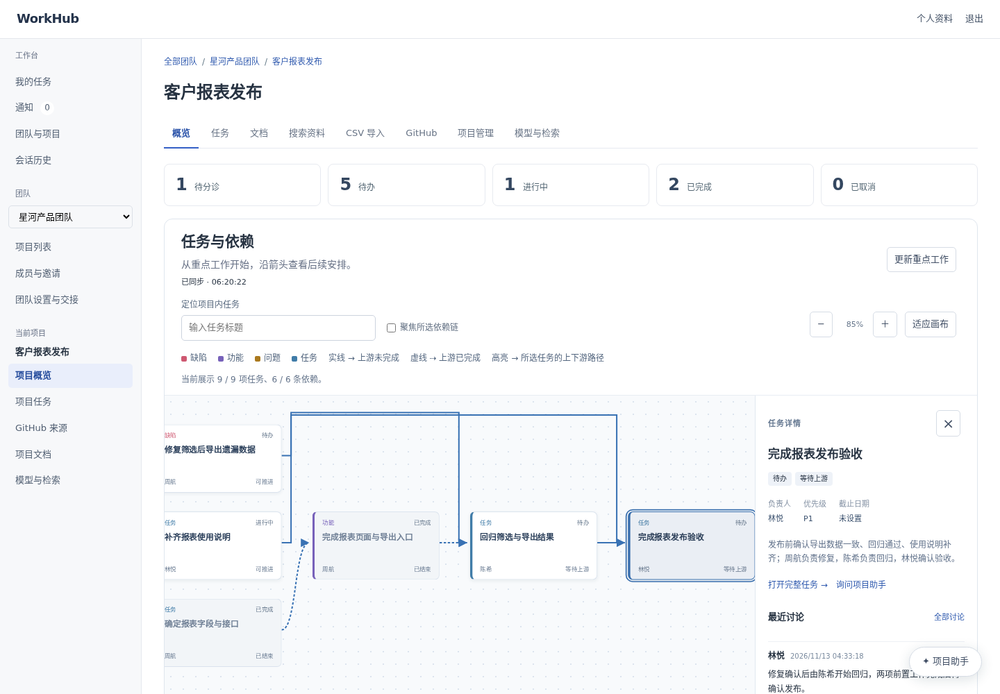
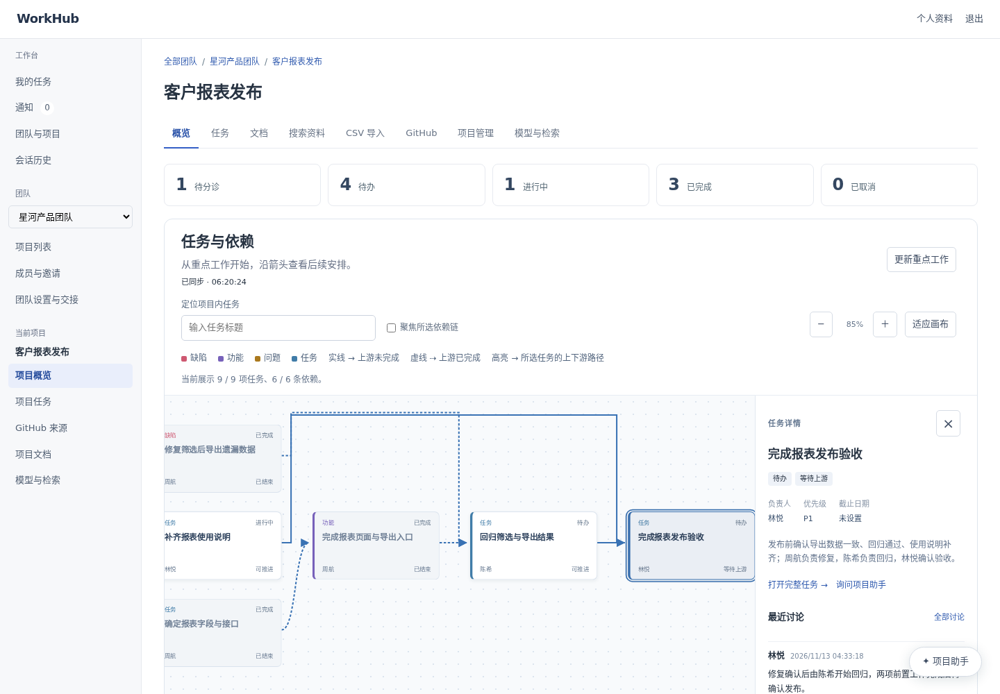
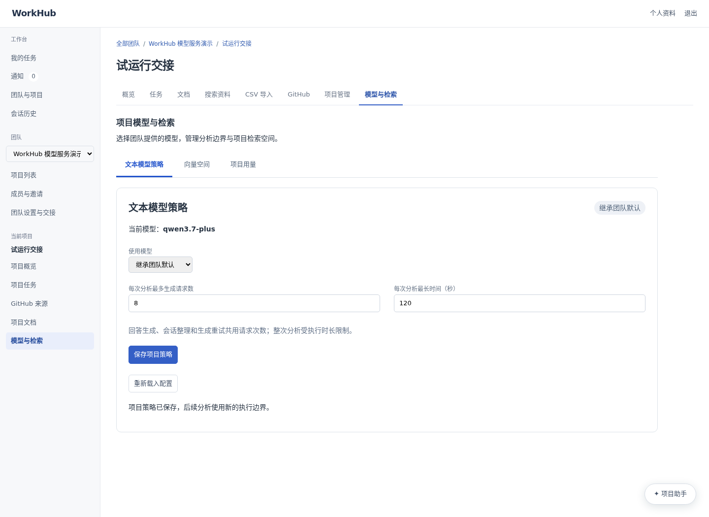

# WorkHub

WorkHub 是面向多个团队的项目协作与知识检索平台。它把任务、前后置依赖、讨论、文档和 GitHub Issue 组织到项目中，帮助成员看清进展与阻塞，并通过带原文引用的项目助手了解背景、安排下一步。

你可以用它完成三件事：从依赖图找出发布卡在哪里；多人协作时自动看到任务与关系变化；让助手结合任务事实和项目资料回答问题，再打开引用核查。

[预览版镜像安装](docs/RELEASE.md) · [源码启动](#本地运行) · [首次体验与模型接入](docs/GETTING_STARTED.md) · [性能与可靠性实验](docs/VALIDATION.md)

默认 Docker 环境即可体验任务、依赖、讨论、文档和实时协作。项目助手、语义检索与 GitHub 同步按需接入团队自己的模型服务和仓库。

## 产品演示

客户报表准备上线时，团队发现筛选后的导出数据存在遗漏。代码修复、测试回归、使用说明、发布验收与公告相互关联，成员需要理清各项工作之间的等待关系，并安排接下来的行动。

### 从概览看清项目现状

项目概览将任务组织成依赖图。节点展示任务类型、状态与负责人，箭头从上游指向后续工作，独立任务集中放在下方。进入时先看到重点工作及其直接关系；可以搜索项目内任意任务、定位其周边，再分页展开上下游。画布同时标记图外关系，方便继续追查影响。

在这个项目中，导出修复完成后才能开展回归；发布验收同时等待回归和使用说明完成；截图素材可以并行整理。


### 点击任务，结合讨论了解背景

选择“完成报表发布验收”，可以高亮它的上游依赖与下游影响，同时查看负责人、工作范围和最近讨论。维护者在讨论中明确验收条件，开发和测试成员补充修复进展与回归安排。

从侧栏可以继续打开完整任务、全部讨论或具体评论，查看资料后返回概览，继续围绕当前任务梳理工作。



### 与成员一起推进下一步

一位成员完成导出修复后，其他成员正在浏览的任务、连线和状态计数会自动更新：回归任务解除直接阻塞，测试成员可以开始核对；发布验收继续等待回归和说明完成。

状态与负责人更新时，成员保持自己的选中任务、缩放和画布位置。阅读讨论期间有新进展，页面会提示更新最近讨论；网络恢复后会继续补齐当前范围，并显示连接状态。



成员也可以向项目助手提问：“报表发布目前卡在哪里？每个人接下来先做什么，哪些工作可以并行？”助手结合任务、依赖、讨论和文档整理回答，并通过引用关联到原始资料，方便继续查阅背景。

## 日常协作

团队可以把日常需求和外部反馈汇集到项目中，确认范围、负责人和优先级，再结合依赖安排执行。

- **推进团队需求。** 成员提交待分诊任务，维护者确认优先级、负责人等安排并接纳，负责人随后推进执行，通过讨论、依赖和关联文档记录进展。需要调整负责人时，可以发起交接申请。
- **跟进 GitHub Issue。** 研发团队通过仓库接收缺陷与需求反馈。项目连接已授权仓库后，将 Issue 同步到项目任务中，参与分诊、负责人安排和依赖梳理。需要回写 GitHub 时，可以查看修改的处理状态和远端确认结果。

维护者还可以使用助手整理分诊建议，查看相关任务与待补问题，编辑建议、选择负责人，再预览并批准接纳。

### 团队接入模型，项目选择策略

团队管理员在“模型服务”中配置文本模型与 Embedding，团队内项目共享对应的调用速率。项目维护者选择可用模型、设置单次分析的生成请求次数与时长，并在资料准备就绪后切换向量空间。成员可以查看项目策略和按月归属的调用用量。



## 本地运行

直接使用已构建镜像，见 [v0.1.0-preview.1 下载与安装](docs/RELEASE.md)。以下为源码构建方式：

准备好 Docker Compose v2、BuildKit 和 Python 3，在仓库根目录执行：

```bash
python3 scripts/init-env.py
docker compose --profile app up --build -d --wait --wait-timeout 300
```

首次启动后，按以下步骤建立团队和项目：

1. 打开 [WorkHub](http://127.0.0.1:18080)，使用自己的演示邮箱注册；密码至少 12 个字符。
2. 打开 [本地邮件收件箱](http://127.0.0.1:18025)，通过邮件链接验证账号。
3. 登录后创建团队和项目，添加任务、上游依赖、文档和讨论。邀请其他账号加入团队后，再授予项目访问权。

该命令会启动 WorkHub、MySQL、RabbitMQ 和 Mailpit。完成注册后即可使用任务、依赖、讨论和文档；项目助手与 GitHub 同步按下方的可选接入说明配置。

首次环境从空团队开始。[首次体验指南](docs/GETTING_STARTED.md)提供“报表发布”的任务与依赖清单，可以按截图场景走一遍创建、查看阻塞、修改和实时同步。

已有应用镜像时，通过 `python3 scripts/init-env.py --image 镜像标签` 保存镜像选择，再使用以下命令启动；下载与校验步骤见[预览版安装](docs/RELEASE.md)。

```bash
docker compose --profile app up --no-build -d --wait --wait-timeout 300
```

```bash
docker compose --profile app logs -f app          # 查看应用日志
docker compose --profile app up --build -d --wait # 更新源码后重新构建
docker compose --profile app down                 # 停止并移除容器，保留数据卷
```

数据库保存业务数据与 CSV 文件，`app-data` 保存邮件加密密钥，应一起备份。需要清空本地环境的数据时，可使用 `docker compose --profile app down -v`，该命令会删除命名数据卷。初始化脚本在缺少 `.env` 时生成配置，已有配置保持原样。

端口默认只绑定本机。修改访问端口时，同时更新 `.env` 中的 `APP_PORT` 和 `WORKHUB_PUBLIC_URL`，保证验证邮件指向正确地址；HTTPS 部署需开启 `SESSION_COOKIE_SECURE`。

## 可选接入

| 能力 | 如何启用 |
|---|---|
| GitHub Issue 同步 | 配置 GitHub App，将安装和仓库预授权给团队，再由项目维护者连接；远端写回有独立开关 |
| 项目助手与分诊建议 | 部署者开启生成模型与共享 Redis，团队管理员在“模型服务”中配置连接；项目维护者在“模型与检索”中设置使用策略 |
| 项目正文检索 | 开启检索并增加 `retrieval` profile，使用 Elasticsearch 搜索项目资料 |
| 语义与混合检索 | 开启检索、Embedding 与共享 Redis；团队管理员配置百炼连接，项目维护者选择空间、重建并切换 |
| 团队共享模型准入 | 增加 `model-governance` profile，为每个团队显式初始化专用 Redis 配额域；跨项目与应用实例共享 |

文本生成和 Embedding 使用团队自带密钥。团队管理员管理模型连接与共享调用速率，项目维护者选择模型、设置单次分析的生成请求次数与执行时长，并管理向量空间。团队与项目的用量页按月展示调用结果和供应商报告的 token。价格与财务预算由供应商平台管理。

部署者提供模型加密主密钥，并为首次配置的团队初始化 Redis 配额域。配置和恢复步骤见[团队模型治理](docs/ARCHITECTURE.md#团队模型治理-api)。

第一次接入时，可按[首次体验指南](docs/GETTING_STARTED.md)依次完成“启动模型依赖 → 团队连接 → 配额初始化 → 项目策略 → 提问与引用核对 → 可选向量索引”。

配置项见 [.env.example](.env.example)。GitHub 预授权命令、集成机制及宿主机开发方式见[架构与运行说明](docs/ARCHITECTURE.md)。

## 工程实现与验证

| 场景 | 实现与已测结果 |
|---|---|
| Issue 同步、索引等后台工作需要失败恢复 | 业务修改与待发布消息同事务保存，发布确认、消费去重与失败恢复配合；32 条消息发布确认的三轮中位耗时约 16 秒降至 1.45 秒 |
| 多个项目与应用实例共享模型服务 | Redis 与 Lua 统一调用速率、冷却和故障状态；双实例三轮受控对照中，两方案各 36 次调用，供应商限流响应由 13 次降至 0 次 |
| 大项目概览需要控制读取与传输开销 | 局部图、批量查询与事务计数；万级任务同条件三轮对照，概览接口 P95 约 96–123ms 降至 27–33ms，首屏 JSON 减少 65.3% |
| 成员需要看到其他人的进展 | SSE 提示变化、按当前范围同步与断线补齐；100 订阅、10 项目、约 5 次成功写入/秒时，浏览器更新可见 P95 为 0.81–0.86 秒 |
| 助手需要查到可靠背景资料 | 结构化业务查询与资料检索结合，回答可展开原文引用；固定 40 题历史技术资料对照中，向量 Recall@10 为 92.5%，关键词基线 73.75% |

完整的[性能与可靠性实验报告](docs/VALIDATION.md)从业务场景讲起，说明测试数据如何生成、175 轮实验怎样安排，以及接口耗时、页面更新和容量数据如何解读；同时记录集中观看的成本、内存校准进展和 Docker 交付结果。

## 开发与验证

前端使用应用直接提供的 HTML、CSS 和 JavaScript；后端为 Java 17 / Spring Boot，使用 JDBC、Flyway、MySQL 和 RabbitMQ。检索与模型准入按需接入 Elasticsearch 和专用 Redis。

```bash
python3 scripts/check-public-tree.py
python3 scripts/test-public-tree.py
scripts/run.sh test  # 需要 Java 17
```

- [架构、核心流程与运行方式](docs/ARCHITECTURE.md)
- [预览版下载、校验与镜像安装](docs/RELEASE.md)
- [首次体验、镜像启动与模型接入](docs/GETTING_STARTED.md)
- [集成测试、浏览器回归与环境准备](docs/TESTING.md)
- [性能与可靠性实验报告](docs/VALIDATION.md)

`main` 保持稳定可运行，开发使用短期分支，验证后合入；展示版本用 tag 标记。提交前检查公开文件范围，暂存后运行 `python3 scripts/check-public-tree.py --staged`。

## 许可

[MIT License](LICENSE)。
