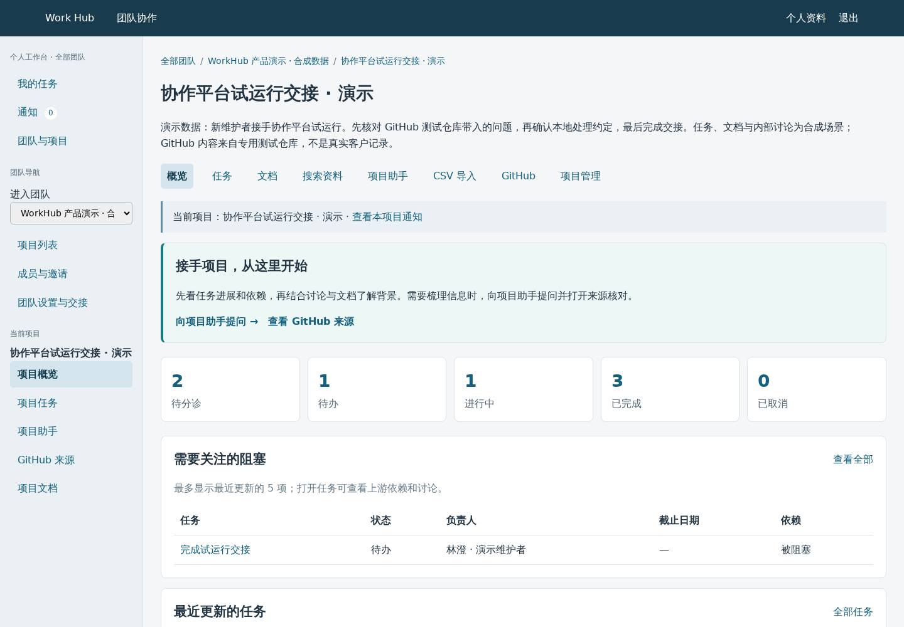

# WorkHub

WorkHub 面向研发团队，集中管理任务、依赖、项目资料和 GitHub Issue。项目助手读取当前项目资料并给出可核对的回答；待分诊任务的建议由维护者编辑、预览并明确批准后，才会提交到业务系统。

## 产品演示

一条典型路径是：接手项目 → 查看进展和阻塞 → 阅读任务、讨论与文档 → 向项目助手提问 → 点击引用核对原文。GitHub Issue 同步后进入同一个任务流程，维护者可以查看分诊建议并决定是否接纳。




截图取自已有本地演示，使用演示任务与资料，回答来自保存的真实模型调用；截图展示该演示版本的布局，不代表模型总体准确率。当前版本还支持项目内助手侧栏、私人会话、持续追问和历史恢复。

| 能力 | 使用方式与边界 |
|---|---|
| 项目协作 | 任务、上游依赖、讨论、文档、站内通知和 CSV 导入；按团队与项目授权 |
| GitHub Issue | 通过预授权仓库同步为任务；本地接纳与远端确认状态分别保存 |
| 项目检索 | BM25、Dense 和 Hybrid；返回当前有权访问的来源与原文位置 |
| 项目助手 | 只读工具查询、资料续读、带引用回答；私人会话按当前项目权限过滤 |
| 分诊建议 | 项目可开启新任务自动分析；维护者仍需预览并明确批准接纳 |
| 后台执行 | 持久任务、幂等处理、阶段进度与断线恢复；费用预算和速率限制可独立配置 |

任务依赖用于呈现阻塞风险；直接上游非 DONE 时视为阻塞，但不作为下游完成的强制门禁。撤权后不再允许读取或提交新业务操作，归档项目保留可读历史并拒绝新业务写入。聊天不创建任务、评论或文档；模型建议不直接写回 GitHub。

## 本地运行

需要 Bash、Python 3、Docker Compose 和 Java 17。已有 JDK 时设置 `JAVA_HOME` 或将 `java` 放到 PATH；Linux x86_64 也可运行 `python3 scripts/bootstrap-jdk.py`，脚本按 [JDK 锁文件](scripts/jdk-lock.json) 下载并校验到 `.tools/jdk`。首次构建需要联网下载 Maven 和依赖。

```bash
python3 scripts/init-env.py
docker compose up -d --wait
scripts/run.sh -DskipTests package
scripts/run-app.sh
```

1. 打开 <http://127.0.0.1:18080>，注册账号，密码至少 12 字符。
2. 打开本地邮件收件箱 <http://127.0.0.1:18025>，通过验证链接启用账号。
3. 登录后创建团队和项目，创建任务、关联上游任务并添加文档与讨论。

默认配置启动 MySQL、RabbitMQ 和 Mailpit，并启用后台消息处理以发送验证邮件。基础协作不需要模型密钥；截图中的演示数据不会自动写入新数据库。

应用目前在宿主机运行，Compose 启动中间件。端口仅绑定本机；HTTPS 部署需启用安全 Cookie。`init-env.py` 不覆盖已有 `.env`，配置变更需自行补齐。停止中间件使用 `docker compose down`，命名卷会保留。生成的 `.tools/mail.key` 必须与数据库一起保留，丢失后已有的加密待发邮件无法解密。

## 可选接入

| 能力 | 前置条件 |
|---|---|
| BM25 检索 | 将 `COMPOSE_PROFILES` 改为 `async,retrieval`，再次启动 Compose，设置 `WORKHUB_RETRIEVAL_ENABLED=true` 并重启应用 |
| Dense / Hybrid | 在检索基础上配置独立 Embedding 端点、密钥、模型维度与预算，显式开启 Embedding |
| 项目问答 / 分诊 | 配置 `WORKHUB_AGENT_*` 与 `WORKHUB_GLM_*`，确认费用授权和预算，再开启助手 |
| 共享模型准入 | 增加 `model-governance` profile，配置配额 scope、速率和 burst，通过 `scripts/model-admission.py` 显式初始化专用 Redis |
| GitHub 同步 | 配置 GitHub App，通过 `scripts/admin.sh` 预授权 installation/repository 并开启 `WORKHUB_GITHUB_ENABLED`；远端写回有独立开关 |

项目自动分诊开关不代替模型费用授权。配置名称与默认值见 [application.yml](src/main/resources/application.yml) 和 [.env.example](.env.example)。

## 测试

```bash
# 公开文件范围、文档链接和检查器回归；无需中间件
python3 scripts/check-public-tree.py
python3 scripts/test-public-tree.py

# Java 单元测试；无需中间件
scripts/run.sh test

# 核心集成回归；使用专用本地测试环境
docker compose up -d --wait
scripts/init-test-env.sh
scripts/test-core.sh
```

核心回归覆盖迁移、任务权限、消息发布、幂等执行和进程退出恢复。浏览器、检索、会话及外部服务测试的前置条件见 [测试说明](docs/TESTING.md)。测试报告与截图写入 `target/`。工程测试通过不等于真实模型回答正确。

## 架构与开发

Java 17、Spring Boot、Spring JDBC/Security/Session/AMQP、Flyway；MySQL 保存业务事实，RabbitMQ 运输后台工作，Elasticsearch 提供派生检索，专用 Redis 协调模型准入。具体版本由 [pom.xml](pom.xml) 和 [compose.yaml](compose.yaml) 固定。

- [架构、核心流程与取舍](docs/ARCHITECTURE.md)
- [测试与公开范围检查](docs/TESTING.md)

`main` 保持可运行版本，开发使用短期的 `feat/...`、`fix/...` 或 `chore/...` 分支，验证后合入；展示版本用 tag 标记。提交前运行公开范围检查，暂存后用 `python3 scripts/check-public-tree.py --staged` 检查实际提交内容。新增运行文件时同步维护检查器的允许清单。

工作记录、实验输出和临时文件存放于忽略目录或仓库外。公开仓库保留正式源码、测试与必要文档；提交文件检查不能清除旧历史，发布前还需确认要公开的提交历史。
