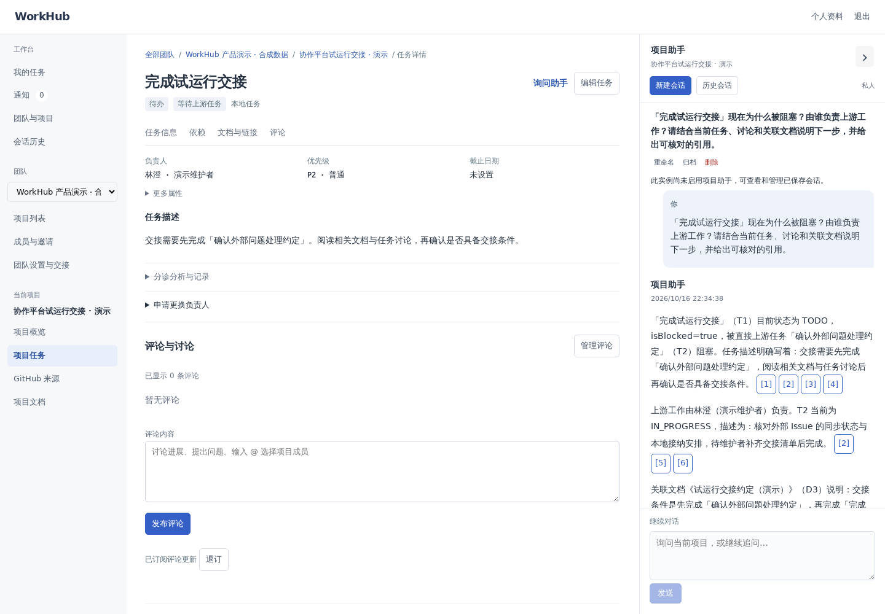

# WorkHub

WorkHub 是一个面向小型研发团队的项目协作工作台。任务、依赖、讨论、文档和 GitHub Issue 放在同一个项目中；接手项目时，可以沿着阻塞关系查找原因，也可以让项目助手读取资料，再通过引用核对原文。

## 产品演示

**先了解进展，再处理阻塞。** 项目概览展示各状态任务、直接阻塞和最近更新；进入任务后，可以继续查看上游工作、负责人、讨论和关联文档。


**带着具体问题查证。** 项目助手在右侧保留会话，支持连续追问；打开引用后可以定位任务、评论或文档，并返回原来那一轮回答。



截图由当前版本采集。任务与文档是本地合成场景；助手展示 2026 年 10 月 16 日保存的真实模型回答，并保留原时间与引用。新启动的数据库为空，不会自动写入演示数据。

| 想完成的工作 | 操作路径 |
|---|---|
| 推进一项需求 | 成员提交待分诊任务 → 维护者确认安排并接纳 → 负责人执行、讨论或申请交接 |
| 把 GitHub Issue 纳入协作 | 连接已授权仓库 → 同步 Issue → 分诊接纳 → 查看同步与远端修改的确认结果 |
| 接手已有项目 | 查看概览 → 沿依赖追查阻塞 → 阅读讨论和文档 → 向助手提问 → 打开引用核查 |

助手问答只读。分诊建议需要维护者编辑、保存、预览并明确批准，才会接纳任务。GitHub 修改“已受理”后仍需等待远端确认。

## 本地运行

需要 Docker Compose 和 Python 3。基础协作可以直接启动：

```bash
python3 scripts/init-env.py
docker compose --profile app up --build -d --wait --wait-timeout 300
```

1. 打开 [WorkHub](http://127.0.0.1:18080)，使用自己的演示邮箱注册；密码至少 12 个字符。
2. 打开 [本地邮件收件箱](http://127.0.0.1:18025)，通过邮件链接验证账号。
3. 登录后创建团队和项目，添加任务、上游依赖、文档和讨论。邀请其他账号加入团队后，再授予项目访问权。

这个启动方式同时运行 WorkHub、MySQL、RabbitMQ 和 Mailpit，无需宿主机 JDK。基础协作不需要模型或 GitHub 密钥；未配置助手时，页面会显示未启用状态。

```bash
docker compose --profile app logs -f app          # 查看应用日志
docker compose --profile app up --build -d --wait # 更新源码后重新构建
docker compose --profile app down                 # 停止并移除容器，保留数据卷
```

数据库保存业务数据与 CSV 文件，`app-data` 保存邮件加密密钥，应一起备份。`down -v` 会删除命名数据卷，仅用于明确要清空数据的环境。初始化脚本不会覆盖已有 `.env`。

端口默认只绑定本机。修改访问端口时，同时更新 `.env` 中的 `APP_PORT` 和 `WORKHUB_PUBLIC_URL`，保证验证邮件指向正确地址；HTTPS 部署需开启 `SESSION_COOKIE_SECURE`。

## 可选接入

| 能力 | 如何启用 |
|---|---|
| GitHub Issue 同步 | 配置 GitHub App，将安装和仓库预授权给团队，再由项目维护者连接；远端写回有独立开关 |
| 项目助手与分诊建议 | 配置模型端点、密钥和费用额度，再开启助手；项目自动分诊设置独立管理 |
| 项目正文检索 | 开启检索并增加 `retrieval` profile，使用 Elasticsearch 搜索项目资料 |
| 语义与混合检索 | 在检索基础上配置独立 Embedding 服务、维度和额度；相关策略通过检索接口使用 |
| 共享模型准入 | 增加 `model-governance` profile，初始化专用 Redis 的速率与配额配置 |

配置项见 [.env.example](.env.example)。GitHub 预授权命令、私钥挂载及宿主机开发方式见[架构与运行说明](docs/ARCHITECTURE.md)。

## 开发与验证

前端使用应用直接提供的 HTML、CSS 和 JavaScript；后端为 Java 17 / Spring Boot，使用 JDBC、Flyway、MySQL 和 RabbitMQ。检索与模型准入按需接入 Elasticsearch 和专用 Redis。

```bash
python3 scripts/check-public-tree.py
python3 scripts/test-public-tree.py
scripts/run.sh test  # 需要 Java 17
```

- [架构、核心流程与运行方式](docs/ARCHITECTURE.md)
- [集成测试、浏览器回归与环境准备](docs/TESTING.md)

`main` 保持稳定可运行，开发使用短期分支，验证后合入；展示版本用 tag 标记。提交前检查公开文件范围，暂存后运行 `python3 scripts/check-public-tree.py --staged`。
