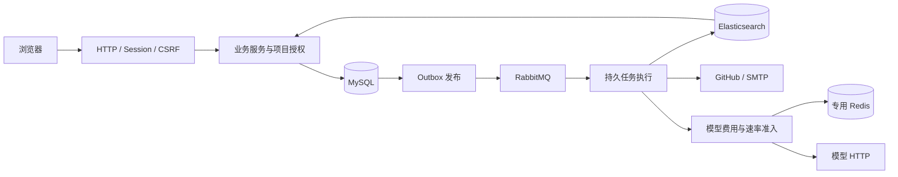

# 架构与核心流程

WorkHub 是一个 Spring Boot 单体应用，前端由应用提供静态 HTML、CSS 和 JavaScript，后端使用显式 JDBC 和 Flyway 迁移。当前入口为 [WorkHubApplication](../src/main/java/dev/workhub/WorkHubApplication.java)，配置见 [application.yml](../src/main/resources/application.yml)。



MySQL 保存业务、权限、会话、工作状态和模型费用账本；RabbitMQ 负责运输与缓冲。Elasticsearch 是可重建的检索投影。独立 Redis 仅在开启共享模型准入时协调速率、冷却和熔断，不能代替 MySQL 费用账本。

## 容器运行

[Dockerfile](../Dockerfile) 使用固定摘要的 Maven/Java 17 构建镜像和 Java 17 JRE 运行镜像。构建上下文由 [.dockerignore](../.dockerignore) 限定为应用源码、构建配置和探针源码；本机 JAR、凭据、文档及测试输出不进入构建。镜像以 UID/GID 10001 运行，Java 进程直接接收停止信号。

Compose 的 `app` profile 启动应用与基础中间件；应用等待数据库和 RabbitMQ 健康后启动，Flyway 执行迁移。容器内使用服务名和内部端口连接，外部端口保持 loopback 绑定。默认 `async` profile 保留宿主机开发方式，检索和共享模型准入分别使用额外 profile。

数据库、消息队列和应用密钥使用独立命名卷。RabbitMQ 使用固定 hostname，容器替换后保持相同节点身份与消息存储目录。应用密钥路径为 `/var/lib/workhub/mail.key`，重建应用容器会复用 `app-data`；CSV 源文件及结果存储在数据库。RabbitMQ 健康探针以 rabbitmq 用户运行，避免首次启动时探针生成 root 所有的 cookie；其 CLI 调度线程和探针超时有界配置，启动等待不改变业务执行期限。

## 宿主机开发

保留容器中间件，在宿主机运行应用时，需要 Bash 和 Java 17：

```bash
python3 scripts/init-env.py
docker compose up -d --wait
scripts/run.sh -DskipTests package
scripts/run-app.sh
```

默认 `async` profile 只启动中间件。已有 JDK 时设置 `JAVA_HOME` 或将 `java` 放到 PATH；Linux x86_64 也可运行 `python3 scripts/bootstrap-jdk.py` 下载锁定的 JDK。同一个数据库同时只运行一种应用启动方式。

宿主机默认 `.tools/mail.key` 和容器的 `app-data` 各自保存邮件密钥；已有数据库切换运行方式时，需要一起迁移原密钥。宿主机端口与容器内部服务地址分别配置，容器内部连接使用服务名及内部端口。

## 模块入口

| 模块 | 责任与主要入口 |
|---|---|
| `config` / `identity` | Session、CSRF、当前身份与项目授权：[SecurityConfiguration](../src/main/java/dev/workhub/config/SecurityConfiguration.java)、[ProjectAccess](../src/main/java/dev/workhub/identity/ProjectAccess.java) |
| `onboarding` | 账号、邮件验证、邀请、团队成员生命周期：[Accounts](../src/main/java/dev/workhub/onboarding/Accounts.java)、[Workspaces](../src/main/java/dev/workhub/onboarding/Workspaces.java) |
| `work` / `activity` | 任务、依赖、正文、订阅及通知：[TaskService](../src/main/java/dev/workhub/work/TaskService.java)、[DependencyService](../src/main/java/dev/workhub/work/DependencyService.java)、[ContentService](../src/main/java/dev/workhub/work/ContentService.java) |
| `messaging` | Outbox、发布确认、消费确认与可恢复执行：[OutboxPublisher](../src/main/java/dev/workhub/messaging/OutboxPublisher.java)、[WorkJobExecutor](../src/main/java/dev/workhub/messaging/WorkJobExecutor.java) |
| `integration.github` | Inbox、同步、远端意图和未知结果核对：[GitHubService](../src/main/java/dev/workhub/integration/github/GitHubService.java)、[GitHubHandler](../src/main/java/dev/workhub/integration/github/GitHubHandler.java) |
| `knowledge` | 正文版本、索引生成与检索：[SourceObligations](../src/main/java/dev/workhub/knowledge/SourceObligations.java)、[KnowledgeService](../src/main/java/dev/workhub/knowledge/KnowledgeService.java)、[DenseSearch](../src/main/java/dev/workhub/knowledge/DenseSearch.java) |
| `agent` | 只读调查、提案批准、调用治理与会话：[AgentEngine](../src/main/java/dev/workhub/agent/AgentEngine.java)、[TriageProposals](../src/main/java/dev/workhub/agent/TriageProposals.java)、[ConversationService](../src/main/java/dev/workhub/agent/ConversationService.java) |
| `importing` | CSV 预检查、逐行提交及恢复：[CsvImports](../src/main/java/dev/workhub/importing/CsvImports.java) |

容器模式下，可用镜像内的 Java 执行部署管理命令，无需宿主机 JDK。以下参数由部署者依据自己的授权仓库填写：

```bash
docker compose --profile app exec app java \
  -Dloader.main=dev.workhub.admin.DeploymentAdmin \
  -cp /opt/workhub/workhub.jar org.springframework.boot.loader.launch.PropertiesLauncher \
  github-grant <Workspace-UUID> <installation-ID> <repository-ID> <owner/repo>
```

## 业务写入与权限

Controller 解析 HTTP 并建立当前 Actor，Service 负责授权、版本和事务，Repository 使用参数化 SQL。Workspace 成员身份不会自动授予所有项目访问权；Workspace ADMIN 也不能直接读取未授权项目正文。

业务写通常先取得 Workspace 授权屏障，再锁 Project，随后检查对象版本并修改业务。撤权与后台批次提交遵循相同锁序。项目锁保障并发正确性，也会成为热点项目的吞吐限制。任务和文档使用版本检查拒绝旧表单覆盖；数据库组合外键保护项目范围，但不代替有效成员校验。

创建任务的典型事务为：授权 → 创建幂等收据检查 → Task → Subscription / Activity / Notification → 来源与后台工作义务 → 保存收据 → 提交。事务失败时业务与义务共同回滚。Actor 类型和项目范围由服务端确定，模型不能通过参数冒充用户。

同项目依赖通过递归 CTE 判环，Project 锁阻止并发创建相互成环的边；检查时间预算耗尽则整体回滚。非 DONE 的直接上游造成阻塞，CANCELED 仍阻塞；阻塞用于提示风险，不强制禁止下游完成。

待分诊任务由维护者确定正式安排并接纳。接纳后，创建者身份不再额外授予编辑权；负责人可推进执行和维护允许的内容，正式安排与改派由维护者管理。交接申请在批准前不改变指派。归档保留可读历史并拒绝新业务写入；最后一位管理员或维护者受保护。

## 页面交互与查询

创建任务、文档和评论时，浏览器保留当前提交的请求标识与内容。响应丢失后，确认原请求会复用同一标识；成功返回后才结束这次创建意图。输入暂时锁定，避免在结果不明时悄悄换成另一份内容。后端仍按当前身份检查权限和幂等收据。

任务详情默认展示最新评论，并通过时间与 ID 游标加载较早讨论。引用深链可以直接定位同任务的历史评论；默认升序评论接口保留给既有调用方。文档列表可继续加载，关联文档使用当前项目内的文字搜索；关联标题直接随关系元数据返回，不依赖首批文档列表。解除关联保留原资料，并检查当前编辑权与任务版本。

项目助手的启用状态通过受项目授权保护的只读接口返回。未启用时可以查看和管理历史会话，页面不会提交新问题；启用状态不代表外部模型连通性或回答正确性已经得到验证。

## 后台执行

业务数据、WorkJob 和初始 Outbox 在同一事务登记。发布器以短事务领取 Outbox，在事务外发送 RabbitMQ，再按领取 token 条件提交结果。租约到期可能产生重复运输，消费端必须依赖持久状态去重。

[WorkJobConsumer](../src/main/java/dev/workhub/messaging/WorkJobConsumer.java) 在 Executor 成功提交后才 ACK。无法持久提交时不确认消息；失败处置先回滚本地效果，再保存重试或终态及停车义务。发布确认不等于业务完成，工作终态也不代表所有外部事实已经确认。

本地 Handler 在短事务中提交效果；[RemoteWorkHandler](../src/main/java/dev/workhub/messaging/RemoteWorkHandler.java) 将准备、外部 I/O 和条件完成分开。attempt token、租约和资源代次拒绝旧执行者提交。该模型依赖至少一次运输和幂等本地效果，不提供跨系统原子性或严格 exactly-once。

CSV 按稳定行身份逐行提交，结果区分成功、失败和未处理。撤权、归档及过期会阻止后续提交；恢复重查当前维护权，已经成功的行不重复创建任务。这牺牲整文件原子性，换取有界事务和可解释的部分结果。

## GitHub 同步与远端意图

GitHub 通知先进入 Inbox，再登记资源观察和后台工作；不直接把 webhook 当作最终业务事实。Issue 首次确认后成为本地镜像，远端标题、正文与关闭状态由读取结果确认，本地接纳和执行安排单独保存。

远端修改依次经历 PRECHECK GET、持久化 SEND_STARTED、PATCH 与 GET 核对。SEND_STARTED 之后恢复执行只登记 VERIFY，避免网络超时后盲目重发可能已经生效的写入。即使 PATCH 返回 2xx，也要经读取和业务应用确认；发送标记已保存却尚未发包时同样采用保守观察。GitHub 并发编辑仍存在无法通过本地锁消除的窗口。

自动分析默认关闭。开启后，可信创建时间晚于开启时间、首次同步且仍待分诊的新 Issue 可以原子登记一次分析；历史回填不触发模型。首次发现分类、唯一任务分析键和版本校验阻止重复登记。关闭时结束排队的自动分析，运行中的下一次模型准入被阻止；已经发送的请求继续记账。

GitHub App 安装归属由部署者预授权，不提供公开 OAuth/安装回调的自动绑定。Agent 批准只执行本地接纳，不修改远端 labels、assignee 或评论。

## 检索与来源有效性

正文变化在业务事务中保存来源 revision/hash 和索引义务。开启检索时，后台生成不可变 canonical chunks，通过发布任务写入 Elasticsearch，按来源、generation 和租约条件激活；关闭时仅做来源校验。旧校验任务成功不能冒充真实索引发布。

BM25 提供词法候选，Dense 使用独立 Embedding 配置和向量产物，Hybrid 在核验两路候选后执行 RRF。查询结果按来源去重，并经 MySQL 重查当前权限、正文版本和 active generation，返回原文位置及实际检索策略。检索降级显式标识；结构化状态、负责人和依赖通过业务工具查询。

来源有效不等于回答正确，top-k 为空也不能证明全项目不存在相关资料。候选窗口和分块有界，`retrievalComplete` 不表示全库召回或 ES 物理完整。自动物理对账和旧索引 GC 尚未实现，当前由维护者 rebuild 恢复。

## 项目助手与提案批准

Run 与后台工作义务共同登记。[AgentTools](../src/main/java/dev/workhub/agent/AgentTools.java) 只提供绑定项目的读取工具；模型不能提交 Actor、任意 SQL 或业务写操作。工具循环限制轮次、工具次数、输入容量、费用与总期限。检索正文属于不可信资料；引用身份和来源版本由服务端绑定，后续读取和发布重新核验。

单任务分诊有固定资料 WORKFLOW、固定资料加有限补查 GUIDED 和自主只读调查 AGENT 三种策略。处置建议、相关任务和待补问题均先保存供人核对；负责人由维护者选择，疑似重复不自动合并任务。

提案版本只追加。预览凭据绑定维护者、版本与内容 hash；明确批准时重查当前权限、任务与讨论版本、负责人和实际观察来源，再由 TaskService 原子接纳并保存唯一执行收据。并发批准串行化，成功收据用于恢复重复请求；编辑草稿或替换版本后不能沿用旧预览。已知范围外的新资料不自动使整个提案过期。

## 模型治理、会话与恢复

[GovernedModelRequests](../src/main/java/dev/workhub/agent/GovernedModelRequests.java) 为每次请求执行权限检查、费用预留及可选共享准入，等待和模型 I/O 不持有业务数据库事务。MySQL 累计费用，专用 Redis/Lua 原子维护令牌桶、冷却和熔断；没有状态时拒绝出站，需显式初始化恢复。429 和指定 5xx 采用分类处理与有限重试，未知网络结果不盲重发；每次重试重新准入。

限流许可在 HTTP 发送边界检查有效期，过期则重新申请。预留、发送与结算是不同事实；进程丢失或调用结果未知时保留未知费用，不按 TTL 自动退款。共享配额不提供 Workspace 公平队列或生产容量承诺。

私人 Conversation 保存 Turn、消息、摘要与 Run checkpoint。上下文按容量压缩，保留近期轮次、完整工具调用配对以及服务端来源和对象注册表；原消息保留并支持有界回读。checkpoint 只在完整工具边界保存；无法确认旧模型响应时明确失败，避免重发未知调用。夹具能验证这些工程路径，真实模型的指代、纠正和摘要保真需分别评估。

阶段进度采用持久快照和 SSE。每次发送前重查会话与当前权限，Servlet 写入前结束数据库事务；重连读取当前快照，不通过重连创建新 Run。多个应用可读取共同数据库中的同一 Run。快照不包含模型输入或思维过程，也不是完整事件重放日志。

取消和删除阻止后续准入与迟到发布。会话删除清理在线正文、摘要、checkpoint 和来源副本，保留无正文账务骨架；备份按部署保留政策处理，不能将在线清理理解为已擦除所有备份。

旧问答导入保留原提问与回答时间、最后活动时间和引用；重复导入返回同一会话，不产生模型请求。
