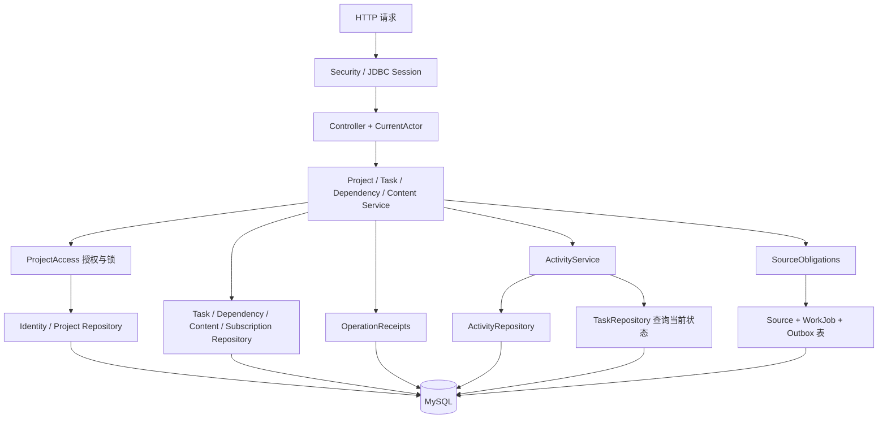
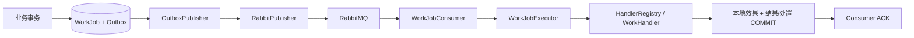
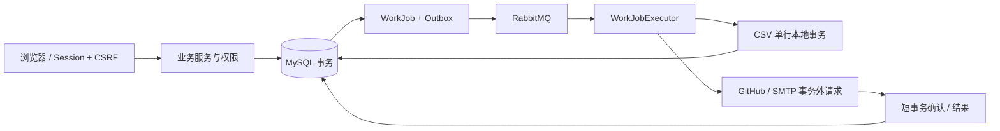

# 当前生产架构

公开基线 · 2026-11-04。 一个 Spring Boot Java 进程、显式 JDBC 数据访问、MySQL 权威数据存储。技术版本以 [pom.xml](../pom.xml)、[Compose](../compose.yaml) 为准。生产启动入口为 [WorkHubApplication.main](../src/main/java/dev/workhub/WorkHubApplication.java#L9)；Flyway 管理迁移，RabbitMQ worker 与 ES 检索可按配置开启。没有 JPA Entity/Repository 框架。检索验证见 [DenseRetrievalIT](../src/test/java/dev/workhub/phase4b/DenseRetrievalIT.java)，助手和分诊范围见[产品规则](PRODUCT_AND_BUSINESS.md)。

## Project Agent 边界

`AgentRuns` 与 RUN_AGENT/Outbox 同事务登记；`agent.read` 使用既有 WorkJobExecutor、RemoteWorkHandler 与 attempt fencing。领取/提交是短事务，GLM调用在业务锁外；发布前及后续读取复核当前授权、业务版本和全部已用来源。来源校验在已有事务中用 JDBC 保存点隔离预期的资料失效，复用当前连接；无外层事务时开启短查询事务。相关事务不启用 JDBC read-only 标记，因为 MySQL Connector/J 禁止在该模式创建保存点，但工具权限仍只有业务只读能力。校验方法本身不另开事务，避免外层读取、校验和逐来源检查同时占用三个连接；失效仍作为可持久化的受控结果处理。`AgentEngine` 控制轮次、工具、累计token/费用/持久deadline；`AgentAudit` 独立提交输入输出与调用预留，进程丢失不自动退款。

Spring AI 1.1.8 原生 Tool Calling 只用于模型协议，Java校验并执行12个读工具，模型不能提交actor/project、SQL或写操作。业务Service/MySQL提供当前事实，4B接口提供不可信知识正文；引用ID/URL、来源版本由服务器绑定。GLM聊天与百炼Embedding使用独立Key、合同和预算，不改变既有向量。运行层为单一工具/答案循环，工程基线见 [AgentBaselineIT](../src/test/java/dev/workhub/phase5a/AgentBaselineIT.java)。本阶段没有通用编排引擎、Python Agent常驻服务或新业务缓存。

### GitHub 自动登记与停止边界（2026-10-16）

`GitHubStore.resource` 固定首次发现来源；初次扫描用 BACKFILL，增量扫描用 RECONCILE，opened 通知用 LIVE，无法确认用 UNKNOWN。`GitHubHandler` 仅在第一次确认并创建镜像时发布 `GitHubIssueImported`，`AutomaticTriage` 在同一事务中比较源创建时间与 V20 的 `enabled_since`，然后登记 Run、触发审计与 Outbox。`automatic_task_id` 唯一键保护首次分析；不会因重复通知、扫描或普通编辑再次登记。V20 对既有开启设置使用迁移时刻作为保守截止，不倒推历史授权。

关闭设置与登记、worker 领取、模型费用准入共用项目锁顺序。排队 Run 结束为 FAILED / AUTOMATIC_TRIAGE_DISABLED；运行中 Run 保存停止标记，后续模型预留被拒绝，已发请求仍正常记账。600秒首次排队上限在 worker 准入并发检查之前执行。当前费用账本仍在 MySQL；可选开启的跨实例 Redis 限流、冷却与故障治理见文末“共享生成模型准入”。SSE已交付阶段快照与页面恢复，自动登记、共享准入及SSE证据分别记录；完整应用联合验收见审校报告W4。

### 5B 单任务接纳合同

`AgentRuns.createTriage` 在当前维护权/项目锁下绑定一个已有本地或 GitHub TRIAGE 任务及 task/discussion revision。独立分诊模式仍只调用原只读工具，输出类型/优先级建议和带引用的分析；负责人始终留给维护者选择。普通问答不能转成提案。`TriageProposals` 只允许 `ACCEPT_TRIAGE`，不接受模型或客户端提供的 actor/project/action/SQL。

V16 的提案版本内容只追加，包含修改前 Task、正式字段、人工说明、原分析和实际观察来源；编辑保留原分析供核对，不伪装为模型重新分析。编辑重新校验任务、负责人和原依据，通过后产生新版本及 hash。预览凭据绑定当前维护者、版本和 hash；批准提交这三者，无有效预览或版本已被替换则拒绝。客户端草稿发生变化立即移除批准入口，服务器也不接受带编辑字段的预览。

批准事务依次取 Workspace 授权屏障 → Project 锁 → 版本及预览检查 → 已有执行收据 → 归档、有效负责人、task/discussion revision、相关来源重验 → `TaskService.acceptTriage(APPROVED_AGENT)` → 唯一执行收据。既有 Service 负责 TODO、订阅、Activity、通知及必要索引义务。正文不变时按原合同不重复登记正文索引。业务变更和收据同事务；数据库异常全部回滚，再另开短事务保存无正文的错误码。执行收据以提案 ID 唯一，与请求幂等键无关；并发请求由项目锁串行化。重试仍校验当前维护权和原预览，但已有成功结果不因后续任务变化或归档被重复执行。

来源重验复用 `AgentTools.validate`：精确正文 revision/hash、结构事实与整数值比较。分诊保存实际观察过的来源，不强制读取全库；目标讨论串额外绑定 discussion revision，新增评论也会失效。已知读取范围之外的新文档/无关任务、日志及通知标读不使提案整体过期。锁内的独立只读来源核验期间，同项目业务写入受项目锁约束。真实语义是否充分由后续小样本评测决定，结构与来源校验不冒充语义正确。

### 分诊调查策略 v1

V17 在 agent_run 保存三种显式 triage_strategy，并绑定各自运行合同。WORKFLOW 由 TriageContext 固定收集目标、首批评论/关联、分诊政策与标题 BM25 候选；GUIDED 共用固定资料，前 3 次模型请求允许只读工具，随后关闭工具；AGENT 自主调查。全部复用 AgentTools 的权限、来源和工具白名单，每次调查至多 40 次工具尝试（含固定收集），不新增写工具。旧 strategy=null 运行按旧合同解释；普通 QA 不进入新协议。

调查结果在 Answer.investigation 保存 recommendation、relatedTasks、questions；相关对象须已有 TASK 正文观察，ID、关系枚举、引用和数组大小均严格验证。NEED_INFO 需要补充问题，疑似重复建议需要对应候选；语义是否正确由独立评测决定。业务接纳仍是单独批准的 ACCEPT_TRIAGE，模型不能自动合并、评论或改任务。

本轮不改变触发机制；API 手动提交后台运行，页面保存提案。固定资料通过同一来源登记通道进入模型；实际观察全部参与有效性检查。固定资料在分析中变更时，WORKFLOW/GUIDED 立即返回 STALE / AGENT_CONTEXT_CHANGED，要求重新发起，不在同一版本沿用旧正文；自主工具循环仍使用既有来源失效处理。每组的截断、查询失败和工具阶段边界均展示给模型并记录审计，不把有界 top-k 当成全库覆盖。

## 分层与依赖

Controller 负责 HTTP 解析、身份转换、调用 Service 和返回值；Service 负责业务规则和事务；Repository 负责参数化 SQL、结果映射。构造函数注入把这些对象组装起来。例外要按代码读：`SourceObligations` 自身是直接使用 JDBC 的 Repository；`IdentityBootstrap` 是启动时直接写数据库的初始化器；Content/Activity 部分返回类型就是 Repository 内部 record，没有额外 DTO 层。

`work → activity → work.TaskRepository` 构成包级双向依赖，但没有 Spring Bean 构造循环。不要把图理解成所有 package 都严格单向。

## package 地图

| package | 当前责任和性质 | 主要依赖 | 阅读建议 |
|---|---|---|---|
| identity | Phase 1 正式身份、项目、成员和授权 | common、JdbcTemplate；身份安全适配由 config 提供 | 必读 ProjectAccess / ProjectService；再读会话与启动身份 |
| config | Phase 1 安全基础设施 | identity、common、Spring Security | 必读 SecurityConfiguration |
| work | Phase 1 Task、DAG、内容、订阅的正式实现 | identity、common、activity、knowledge、JDBC | 核心必读；按业务链而非文件顺序 |
| activity | Phase 1 时间线、固定通知、收件人过滤 | identity、common、work.TaskRepository、JDBC | 配合 Task/Comment 副作用阅读 |
| knowledge | 来源/义务、canonical chunks、TEXT generation、BM25 与当前正文核验 | common、messaging、identity、JDBC、ES REST | SourceObligations → IndexTextHandler → PublishTextHandler；读链 KnowledgeService / KnowledgeReads |
| common | Phase 1 错误、输入、ID/时间、JSON、幂等收据 | Spring/JDBC/Jackson | 随调用按需读，不必一开始钻入全部工具 |
| agent | 只读问答与单任务分诊提案 | 读业务服务；批准后调用 TaskService | AgentRuns、AgentEngine、TriageProposals |
| integration.github | GitHub App HTTP、Inbox、lane、intent、reconcile | work、activity、knowledge、messaging、JDBC | 先读 GitHubHandler / GitHubService |
| messaging | Phase 2 发布、消费、重试、审计、受控恢复 | JDBC、Spring AMQP、knowledge handler | 从 CODE_MAP 的 messaging 路线开始 |
| summary | 只有 package-info，后续摘要预留 | 无业务实现 | 暂跳过 |

源码入口：[生产目录](../src/main/java/dev/workhub/)。部分 `package-info.java` 仍保留 Phase 0 的 future 描述，不能据此否定同包内已经存在的业务实现。逐类职责及方法见 [CODE_MAP](CODE_MAP.md)。

## 三条跨模块写入链

这些调用发生在发起 Service 的同一个数据库事务里。下列是成功新写入路径；幂等重试、no-op 和异常会提前结束。

**创建 Task**：[TaskController.create](../src/main/java/dev/workhub/work/TaskController.java#L26) → [TaskService.create](../src/main/java/dev/workhub/work/TaskService.java) → ProjectAccess.lock → OperationReceipts.find → TaskRepository.insert → SubscriptionRepository.participate（创建者/负责人）→ SourceObligations.changed → ProjectRepository.increment → ActivityService.record / assigned → OperationReceipts.save → 提交。

**创建 Comment**：[ContentController.createComment](../src/main/java/dev/workhub/work/ContentController.java#L72) → [ContentService.createComment](../src/main/java/dev/workhub/work/ContentService.java#L103) → 项目授权锁与 Task 检查 → receipt 查询 → insertComment → TaskRepository.discussionChanged → COMMENTER 参与 → IdentityRepository.activeMentions 与 MENTION 参与 → subscribers 合并收件原因 → 来源义务 → COMMENT_CREATED Activity → 过滤并写 Notification → receipt 保存 → 提交。

**修改 Dependency**：[DependencyController.add](../src/main/java/dev/workhub/work/DependencyController.java#L27) → DependencyService.add（事务入口）→ [DependencyService.execute](../src/main/java/dev/workhub/work/DependencyService.java#L78) → 建立时间预算、校验批次 → ProjectAccess.lock → add 的 receipt 查询 → expectedBusinessRevision 检查 → 端点检查 → 保存受影响任务之前的 blocked 状态 → 先删后加，每次新增前 CTE 判环 → Activity / 解除阻塞通知 → Project revision +1 → 有 key 时保存 receipt → 预算检查 → 提交。内部 replace 复用同一路径，没有 Controller 入口。

拆开这些能力是因为它们回答不同问题：业务对象保存状态，Subscription 保存关注关系，Activity 保存事实，Notification 保存收件人，Source 保存文本来源及待办义务。详细区分只维护在[工程概念](ENGINEERING_CONCEPTS.md#side-effects)。

## 数据库与事务边界

| migration | 作用 |
|---|---|
| [V1](../src/main/resources/db/migration/V1__domain_task_dag.sql) | 身份/空间/项目；Task/Dependency；Comment/Subscription；Document/URL/关联；Activity/Notification；OperationReceipt；Source/WorkJob/Outbox |
| [V2](../src/main/resources/db/migration/V2__jdbc_sessions.sql) | Spring Session JDBC 会话表 |
| [V3](../src/main/resources/db/migration/V3__case_sensitive_domain_enums.sql) | 枚举列大小写敏感 collation，防止小写非法状态通过 CHECK |
| [V4](../src/main/resources/db/migration/V4__reliable_async_execution.sql) | 精确 envelope 字节、发布诊断、FailureRecord、transport recovery epoch |
| V5 / V6 | GitHub 连接、Inbox、intent 与分段观察 |
| V7 / V8 / V9 | 账号/团队生命周期、CSV 行结果、GitHub 用户 operation；兼容升级保留旧外键 |
| V10 / V11 | 任务改派请求与镜像 TRIAGE 审批；沿用本轮前已有工作区 |
| V12 | 文档软删除、固定检索配置、source/index state、generation/chunk、回填收据 |

UUID 使用 BINARY(16)，时间使用 UTC DATETIME(6)，日期使用 DATE。`(project_id,id)` 等组合唯一键与组合外键保护项目范围；Dependency 两端 FK 与自环 CHECK、边唯一键保护基础结构。数据库不检查整个 DAG 是否有环，也不代替 active membership 业务授权。

写业务通常使用 READ_COMMITTED 事务，先取 Workspace 授权屏障，再检查授权并锁目标 Project；不同领域版本仍需各自检查。具体锁行、版本推进、超时限制见[工程概念](ENGINEERING_CONCEPTS.md)，不把“项目锁”和“项目版本”当作同一机制。

## 配置、外部组件与真实边界

[application.yml](../src/main/resources/application.yml) 配置 MySQL/Hikari、Flyway、JDBC session、未知 JSON 字段拒绝、2 秒 Dependency timeout 和 1000 层递归上限。Cookie 默认 Secure/HttpOnly/SameSite=Lax。安全过滤器负责登录和 CSRF，项目角色检查仍在 Service 的 ProjectAccess 中。

[Compose](../compose.yaml) 的 minimal / async / retrieval / full 是基础设施组合。RabbitMQ 在 workhub.messaging.enabled=true 时真实参与生产执行；ES 在 workhub.retrieval.enabled=true 时用于 BM25。应用原始配置默认关闭两者；本地 `.env.example` 使用 async 基础设施并开启消息处理以支持验证邮件，检索仍关闭。`model-governance` profile 提供独立noeviction Redis；仅在 `workhub.model-admission.enabled=true` 且已显式初始化配额后参与生成模型调用准入，现有缓存Redis不承担该职责。

SourceObligations 同事务写 `knowledge_source`、默认 WAITING 的 `work_job` 和默认 PENDING / UNHANDLED 的 `outbox_message`。关闭检索时沿用 Phase 2 validation；开启时 INDEX_TEXT 生成不可变 canonical chunks 并登记 PUBLISH_TEXT。ES 是可重建的派生索引，MySQL 的当前 source/owner 和 active generation 决定证据资格；网络查询后再次核权，不直接交付 ES 正文。实现与故障验证见 [RetrievalIT](../src/test/java/dev/workhub/phase4/RetrievalIT.java)。

PUBLISH_TEXT 复用 RemoteWorkHandler，在事务外 create-only 写 ES，逐项确认、冲突核对完整 payload、refresh 后按 lease/source/generation 条件激活。只有这一不可变写 handler 显式允许安全失败重试；GitHub 未知写仍只观察。回填生成新义务，不能把旧 validation DONE 或失败记录改成真实发布完成。

## 可靠异步执行与扩展边界

MySQL 是工作事实的权威存储：WorkJob 保存逻辑工作及不可变成功结果，Outbox 保存运输义务及本条消息的消费处置。RabbitMQ 负责运输和缓冲，不替代 Job 状态。发布与消费字段独立，confirm 不等于业务完成。

| 事务责任 | 必须保持的边界 |
|---|---|
| 业务登记 | 业务数据、Source、Job、初始 Outbox 同提交；SourceObligations 的 MANDATORY 强制使用调用者事务 |
| 发布 | 短事务领取 Outbox；事务外发 Rabbit；按 claim token 条件回写。lease 到期允许接管，因不确定窗口而重复发送是合法行为 |
| 本地执行 | Executor 开独立事务，Project → 必要业务行 → Job → Outbox 的锁序；锁后检查终态/代次，本地 effect、DONE/result、消费处置同提交 |
| 执行失败 | 原 effect 回滚后另开处置事务，持久登记 retry 后继或终态失败与停车义务；不能 ACK 掉尚未保存的下一步工作 |
| 消费确认 | Executor 提交成功返回后才 ACK；无法持久提交就不 ACK，连接关闭后允许重投 |

可靠性模型是 at-least-once transport + 持久本地状态 + 幂等本地效果，不提供 exactly-once 消息或跨系统原子性。成功结果不重置；失败审计在 MySQL，停车队列是摘要运输。显式 epoch 只修复未终态 Job 的运输，不把健康积压当作故障，也不重开 DONE/FAILED。

普通 WorkHandler 仍只做短本地 SQL。Phase 3 的 RemoteWorkHandler 使用 RUNNING、token lease 和分段事务，网络调用在事务外；详见下节。Handler 不自行 ACK。

`IndexTextValidationHandler` 只生成来源/revision 校验收据。真实索引将需要新的版本化义务，不能重置已有 DONE 结果。新增 Java Handler 还需检查 transport 入口：listener/validator 接受 knowledge.index 和严格绑定 GITHUB_WORK 的 github.work；routing key 与 Handler key 是不同定位机制。

状态、重试、拓扑与异常映射的入口见 [CODE_MAP](CODE_MAP.md#messaging)，工程验证见 [phase2 测试](../src/test/java/dev/workhub/phase2/)。

## GitHub 远端执行

`GitHubService` 原子保存 Inbox/ROUTE/Outbox 或 intent/DISPATCH/Outbox。`GitHubHandler` 通过 `RemoteWorkHandler` 的 prepare → perform → complete 运行；prepare/complete 在短事务，perform 在事务外。WorkJobExecutor 持久领取 RUNNING/token/lease 后才调用 HTTP，complete 再核验 token；业务 Handler 同时核验 resource generation/lease/captured seq。项目使用写锁，与 Phase 1 confirmed 副作用协议一致；安装 lane 限制并发，不持 SQL 行锁等待 HTTP。

PRECHECK GET、SEND_STARTED 提交、PATCH、验证登记是不同边界。SEND_STARTED 后重领只登记 VERIFY；PATCH 2xx 也必须经过 GET 和 `TaskService.applyGitHub` 才改变 confirmed。任务结果 DONE 只说明阶段完成。GitHubMaintenance 只补过期运输和登记扫描，不从数据库直接执行普通业务。显式运输 recovery 与网络调用授权分离。

V5/V6 复用 external_resource 的 seq/generation/lease，新增连接、Inbox、IssueLink、SyncIntent、外部评论/来源、安装限流、证据元数据。外部评论不占本地 comment.author_id，也不把 GitHub login 映射为本地 mention。PR/CI/commit 只更新引用证据，不驱动 Task status。已有迁移保持不变，迁移验证见 [GitHubMigrationIT](../src/test/java/dev/workhub/phase3/GitHubMigrationIT.java)。

## Phase 3.x：owner 速览

下文沿权限、CSV 与 GitHub 三条路径解释请求、事务、队列和结果确认。

Work Hub 解决三个问题：团队成员进入/离开后谁还能访问工作；任务/依赖/正文如何保持可靠历史；批量和远端操作如何显示可信结果。MySQL 保存权威事实，RabbitMQ 运输工作，浏览器只调用正式 HTTP API。未增加身份服务、第二套队列或模型依赖。

User 通过 WorkspaceMember 加入团队，通过 ProjectMember 获得某个项目的正文访问权；两层角色独立。Project 拥有 Task、依赖边、评论、Document 和 Activity；Notification 指向某个 Activity。CsvImport 固定一次上传，每个 ImportRow 最多关联一个成功 Task；GitHubConnection 固定预授权仓库，GitHubOperation 汇总一轮发现的资源，SyncIntent 保存任务对应的一次远端修改意图。这些业务对象通过 WorkJob/Outbox 登记执行义务。

空间授权、项目状态、成员关系、任务版本、CSV成功行及其任务必须在提交点一致。邮件、导入进度、GitHub confirmed 可以稍后到达；202/入队不等于业务成功。业务 operation 是用户的一次导入或同步轮次；WorkJob 是其中一个可重复运输的执行步骤。成功 WorkJob 不被重置，恢复创建有明确代次的新工作。

**入口导航：** [账号与团队](../src/main/java/dev/workhub/onboarding/)、[项目协作](../src/main/java/dev/workhub/work/CollaborationService.java)、[CSV](../src/main/java/dev/workhub/importing/CsvImports.java)、[GitHub](../src/main/java/dev/workhub/integration/github/GitHubHandler.java)、[统一执行器](../src/main/java/dev/workhub/messaging/WorkJobExecutor.java)、[浏览器](../src/main/resources/static/app.js)。迁移 V7–V9 增量保留 V1–V6；[迁移测试](../src/test/java/dev/workhub/phase3x/MigrationAndLimitsIT.java)核对旧身份、作者和空库两条路径。

### 路径一：邀请、授权与撤权

[WorkspaceController](../src/main/java/dev/workhub/onboarding/WorkspaceController.java)取得当前会话身份；[Workspaces.invite/accept](../src/main/java/dev/workhub/onboarding/Workspaces.java)在 Workspace 排他锁下验证管理员、目标邮箱、有效期和消费状态，写成员和管理记录。接受邀请只建空间 MEMBER，项目授权另走 ProjectService.member。

邀请重复消费返回原空间，不重新激活已被撤销的访问；撤销/过期拒绝。移除先核对最后角色，再按 ID 锁项目、停用本空间的项目关系和空间关系。普通业务/worker 先取 Workspace 共享锁，再取 Project 锁；因此撤权提交之后，后续批次不能按旧权限落库。ADMIN 交接只看管理摘要，显式授予项目权后才可读正文。

看 [CollaborationIT](../src/test/java/dev/workhub/phase3x/CollaborationIT.java) 的 invitationsAndWorkspaceIsolation、concurrentAdminAndMaintainerDowngradesKeepOne、scopedAdminCannotReadProjectUntilExplicitHandover，分别理解重新加入、并发最后角色、ADMIN 边界。账号凭证逻辑在 [Accounts](../src/main/java/dev/workhub/onboarding/Accounts.java)，邮件重用 [MailHandler](../src/main/java/dev/workhub/onboarding/MailHandler.java) 的远端执行协议。

### 路径二：CSV 确认、部分成功与恢复

[CsvController](../src/main/java/dev/workhub/importing/CsvController.java)上传限额文件；[CsvFormat](../src/main/java/dev/workhub/importing/CsvFormat.java)解析固定格式；CsvImports.upload 冻结输入并预检查。confirm 在项目锁内登记每行 Job/Outbox，不直接循环写业务任务。消费时 Workspace → Project → Job/Outbox，execute 重查操作者、归档、负责人，调用既有 TaskService，行结果与任务及源义务一起提交。

工作身份是 import ID / row；每次恢复另有 generation，成功行和幂等收据保持不变。撤权/归档记录 STOPPED，未处理行保持 PENDING；维护者显式接手恢复。数据库异常回滚任务，执行器持久失败处置同时更新行结果。下载入口重新查权限，保留期清理独立于业务任务历史。

看 CollaborationIT 的 csvPartialIdempotencyArchiveAndResume、failedRowTransactionHasNoPartialTaskAndCanSafelyRetry、realProcessExitAfterPartialCommitResumesWithoutDuplicates；最后一项由 [CsvCrashWorker](../src/test/java/dev/workhub/phase3x/CsvCrashWorker.java)真实 halt 子 JVM，证明部分提交后重启重投不会重复任务。分页规模证据由同测试类的 representativePaginationAndIndexEvidence 生成。

### 路径三：GitHub 本地意图、发送与确认

[GitHubService.intent](../src/main/java/dev/workhub/integration/github/GitHubService.java)在业务事务中保存 revision/base/desired 与 Job；[GitHubHandler](../src/main/java/dev/workhub/integration/github/GitHubHandler.java) prepare 领取，perform 在事务外 GET/PATCH，complete 在重新锁定和授权后应用。SEND_STARTED 是持久发送边界；之后即使网络断开、进程退出、归档或撤权，也只能观察，不能当未发过重试。

TaskService.applyGitHub 将确认事实原子应用到任务、依赖解除 Activity 和通知。连接的部署授权在 [DeploymentAdmin](../src/main/java/dev/workhub/admin/DeploymentAdmin.java)，运行汇总在 [GitHubManagement](../src/main/java/dev/workhub/integration/github/GitHubManagement.java)，底层扫描仍使用原 WorkJob 协议。

看 [GitHubSyncIT](../src/test/java/dev/workhub/phase3/GitHubSyncIT.java) 的未知写、进程退出、发送前撤权、分页失败和身份不符测试；外部服务冒烟入口另见 [external 测试](../src/test/java/dev/workhub/external/)。本地 fake 测试能控制故障窗口，不能证明 GitHub 服务端全部真实行为。

### 主要取舍

Workspace 共享锁让权限撤销与每批提交形成简单可证明边界，代价是成员管理会等待正在提交的短事务；不在 SQL 锁内等 GitHub/SMTP。CSV逐行提交牺牲全文件原子性，换取有界事务、可解释部分结果与恢复；它不等同未来 Agent 批量 proposal。最小静态页面减少前端构建复杂度；正式分页 API 保留，聚合详情有界。角色固定两层，不引入自定义 RBAC。

## 个人入口的查询边界

个人导航跨团队聚合的是当前用户的授权视图，不是新的业务归属。任务仍归 Project，通知仍指向项目 Activity。[CollaborationService.query](../src/main/java/dev/workhub/work/CollaborationService.java)返回任务及团队/项目元数据；[ActivityRepository.inbox/unreadCount](../src/main/java/dev/workhub/activity/ActivityRepository.java)在 SQL 中联合用户、WorkspaceMember、ProjectMember 和收件人条件。全局标读重新取得 Workspace/Project 权限锁，不信任浏览器携带的项目归属。复用原 recipient/id、recipient/read_at/id 索引，无新增迁移或通知调度。

[NavigationIT](../src/test/java/dev/workhub/phase3x/NavigationIT.java)验证同名项目的来源、服务端组合筛选、ADMIN 的项目隔离、通知收件人、撤权后的列表/计数/标读、归档与游标分页。交互取舍与外部参考集中在[产品规则](PRODUCT_AND_BUSINESS.md#导航与信息范围2026-09-27-交互修订)。

## 共享生成模型准入

`AgentEngine → GovernedModelRequests → ModelAdmission / AgentAudit → GlmChatModel` 对 QA 与三种分诊策略使用同一条物理请求管线。生成模型每轮及每次可重试发送都重新准入；Redis名额确认后重新鉴权/校验attempt，再提交短事务费用预留。HTTP适配器在构造客户端之后、发送之前再次校验权限、期限和500ms名额有效期；过期则重新申请并复用未发送预留。Redis和HTTP不构成原子操作，发送检查后的进程暂停仍是限制。

启用共享准入时，启动阶段先对专用Redis执行PING和只读的脚本预热，初始化Lettuce/Netty连接、脚本执行与响应解码路径。预热操作不申请令牌、不初始化配额，也不改变冷却/熔断/半开状态；失败只记录异常类型，普通业务API仍可启动，模型请求继续失败关闭。首次500ms命令超时不能覆盖全部JVM冷启动开销；W4分别保留仅连接预热与完整命令路径预热的验证结果，不承诺消除运行时调度延迟。

Redis Lua 使用服务端TIME、配置指纹和单scope哈希原子更新令牌桶、最大冷却及熔断代次；90秒有效的permit receipt让重复结果最多计一次，旧代次不能关闭新熔断。冷却的迟到429仍可延长截止时间。OPEN快速结束本次分析；65秒探测资格到期会再次OPEN，避免探测进程消失后永久卡住。语义错误不计指定5xx；半开探测未取得健康结果时重新OPEN。异常Retry-After不猜测短冷却，要求运维恢复。Lua状态无TTL，专用Redis采用noeviction；状态缺失失败关闭，只有显式运维初始化从空桶和恢复期开始。

`AgentAudit` 持久化每Run等待与额外重试上限。等待先预占最多15秒时间额度，正常返回扣实际经过时间，崩溃保守保留；旧attempt不能退还等待额度。费用UNKNOWN保持原预留，不因SDK重试、重启或晚到完成退款。已预留后若在发送前失败，也可能保守保留为UNKNOWN；本版不引入自动退款，因此预留笔数、确认HTTP发送数、估计实际费用必须分开统计。预算行登记由 `INSERT IGNORE` 改为不改写合同的重复键UPDATE：双进程实测发现前者先取得共享锁、再FOR UPDATE升级时形成死锁；现在直接取得排他锁，随后仍核对计费合同与条件扣款。

这层没有引入公平队列、TPM、通用熔断框架、Redis任务队列或Agent检查点恢复。默认关闭，开启与恢复命令见根README；参数是实际供应商配额映射，不能按项目复制全额。局部工程验证使用非零虚拟价格、真实MySQL/Redis、本地HTTP模型替身和独立JVM，不代表付费模型语义质量或生产容量。

## Agent 进度与连接恢复

`AgentProgress` 从 `agent_run` 和最新 `agent_trace` 读取轻量权威快照，只输出阶段、有限等待原因、状态及错误码，不装载模型输入、回答正文、工具参数或思维过程。终态答案仍须走 `AgentRuns.get` 的来源校验。旧 attempt 的迟到 trace 不用于描述当前阶段；快照序号用于客户端去旧，不能作为完整事件重放游标。`recordedAt` 是记录插入时间，不宣称是事务提交时间。

`AgentProgressStreams` 每500ms用短只读事务读取一次；每次发送前重查JDBC会话、账号、Workspace/Project成员关系及QA本人/分诊维护者权限。事务在Servlet写入前结束。Servlet非阻塞输出没有应用层事件队列；写通道不就绪时不积压帧，下次发送重新读取快照。每实例最多64连接、2个轮询线程，每帧最多4096字节；检测到不可写持续5秒后关闭，60秒连接期限后客户端重连。独立看门狗负责期限，但实际网络缓冲、代理背压仍需联合环境验证；不能据此宣称“不读客户端建立5秒后必然被检测”。

客户端每页只订阅当前Run，切页/改选/终态关闭旧连接；断线时先读快照确认当前权限，再由EventSource重连。QA和分诊保存提交意图的请求键及原请求，未确认响应时沿用它们；Run放入URL便于刷新恢复。不会靠重连创建新分析，也不为展示阶段引入Redis Pub/Sub。跨实例读取以共同数据库为事实源。W4真实浏览器三组共9次切换订阅实例，连接建立后2—30ms显示同一Run；断开至显示的总耗时1.561—3.756秒另列，不与连接后时延混用。真实TCP背压仍未验，不能用受控慢写测试代替实际网络时限。
