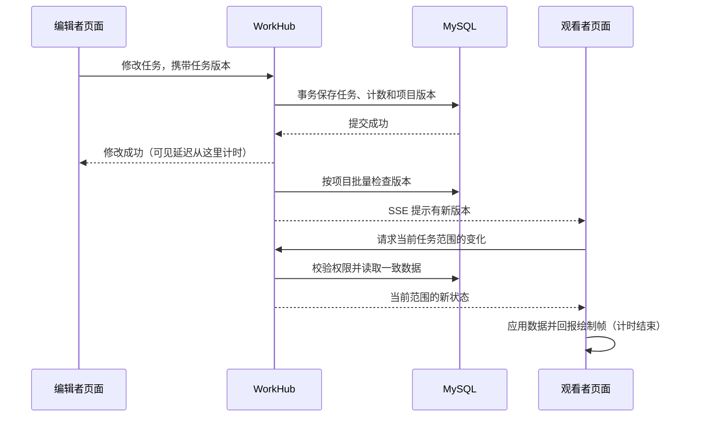

# WorkHub 性能与可靠性实验报告

记录日期：2026-11-15。概览与实时协作的云端测试在当日 08:27 完成。

WorkHub 用于多人管理项目任务、依赖、讨论和资料。例如，报表发布需要等待导出问题修复、回归完成和使用说明补齐；成员打开项目概览，可以看到谁在处理哪件事、发布被什么阻塞，也可以通过助手查阅背景资料。

这组实验围绕实际使用过程展开：项目变大后打开页面要等多久？其他人修改任务后，观看者多久能看到？许多人同时观看时，系统先在哪一步变慢？出现重复消息、并发修改或应用重启时，业务结果是否仍然正确？

**阅读顺序：** 先看第 1 节了解成果；第 2–5 节说明环境、造数和测量方法；第 6–8 节解释查询与协作结果；第 9 节说明内存诊断；第 10–12 节展示其他专项与容器交付。最后附有 20 项验收目标，便于按需核查。

## 1. 已经得到什么结果

| 读者关心的问题 | 已测结果 | 对实际使用的意义 |
|---|---|---|
| 一万条任务的项目，打开概览是否足够轻量？ | 同条件三轮对照，概览接口 P95 从 96–123ms 降至 27–33ms；初始 JSON 从 88,683 降至 30,775 字节 | 页面先呈现当前需要的任务和关系，减少数据库读取、数据传输与浏览器处理 |
| 多个项目同时工作，别人能及时看见更新吗？ | 100 个页面订阅分散在 10 个项目、全局约每秒 5 次成功修改时，真实浏览器更新可见 P95 为 0.81–0.86 秒 | 从一次修改成功到另一个页面完成更新，约 95% 的观测在这一时间内完成 |
| 200 个页面同时观看会怎样？ | 分散到 50 个项目时，计划每秒 20 次修改，实际约 19.8–19.9 次；集中观看一个项目时，实际约 5.7–6.9 次 | 容量与“每次修改会影响多少观看者”密切相关；集中观看是更重的工况 |
| 加快读取后，数据还对得上吗？ | 169 轮工作流核对中，最终版本、任务事实和页面计数差异均为 0；172 轮数据库独立审计无计数漂移 | 同时核对了响应速度和业务结果 |
| 从源码交付后能否正常使用、保留数据？ | Docker 源码构建、注册收信、基础协作、应用替换及整套容器替换后的数据恢复通过 | 已验证首次启动和后续替换应用的主要使用过程 |

云端概览与实时协作共完成 **175 轮**。预先设定的 20 项编号目标中，**19 项通过，1 项内存增长目标待校准后复验**。内存原始数据及诊断结论在第 9 节集中解释。

可靠异步、Redis 模型调用治理、并发写入和资料检索还各有独立实验，见第 10 节。它们分别使用与问题匹配的测试环境。

## 2. 测试在什么环境中进行

### 2.1 云端性能环境

应用、数据库、自动化请求程序和 Chromium 浏览器运行在同一台云主机上，共享这台机器的 CPU 与内存。

内存单位中，1GiB = 1,024MiB；数据体积中，1KiB = 1,024 字节。表里的设置用于固定测试资源，右列说明它们与使用体验的关系。

| 配置 | 实际设置 | 如何理解 |
|---|---|---|
| 云主机 | 4 vCPU，系统可见内存约 7.35GiB（7,522MiB），无 swap | 一台小型服务器；负载发生器也消耗这台机器的资源 |
| 操作系统 | Ubuntu 22.04.5 | 正式性能环境使用宿主机上的应用和 MySQL |
| Java | JDK 17.0.21 | Java 进程负责处理请求、生成响应和发送实时通知 |
| 应用堆内存 | 单进程 512MiB；双进程各 256MiB | 堆是 Java 存放对象的主要空间；两种部署的总堆预算均为 512MiB |
| 应用可见处理器数 | 单进程 4；双进程各 2 | 固定 Java 运行时据以配置部分线程与回收工作的处理器数 |
| MySQL | 8.0.46，buffer pool 512MiB | buffer pool 是数据库保存常用数据页的内存空间 |
| 数据库连接池 | 每个应用进程最多 5 条连接 | 可理解为每个进程同时有 5 个访问数据库的服务窗口；其他请求可能等待 |
| 持久化设置 | `innodb_flush_log_at_trx_commit=1`、`sync_binlog=1`，开启 ROW/FULL binlog | 保留事务日志持久化设置，提交过程包含相应成本 |
| 协议客户端 | Node.js，使用本机 HTTP 和 SSE | 大量模拟页面按真实接口完成登录、订阅、同步和核对 |
| 浏览器观察者 | Playwright 驱动 Chromium | 打开实际前端，检查页面是否应用数据并进入绘制帧 |
| 浏览器网络 | 延迟 50ms，下行 10Mbps、上行 5Mbps | 为真实浏览器增加可控网络成本；协议客户端走未限速的本机网络 |
| 浏览器视口 | 桌面 1440×1000；窄屏 390×844，窄屏另设 4 倍 CPU 降速 | 检查较小屏幕和较慢处理能力下的页面表现 |

这里的“单 JVM / 双 JVM”就是同时启动一个或两个 Java 应用进程。两个进程访问同一个数据库，验证通知与数据同步能否跨应用实例工作。双进程合计有 10 条数据库连接，单进程有 5 条；两组结果体现的是这两套完整配置的表现。

概览矩阵专门测任务查询、写入与实时协作，关闭模型调用、向量检索、GitHub 同步和消息后台任务。这样可以清楚看到这条链路的资源成本。模型、检索、异步恢复的专项测试另行运行。

### 2.2 对照版本与容器环境

查询对照使用两个版本：**B0 为原概览实现，B1 为局部图、批量读取、项目计数与实时同步方案**。生产功能代码基准为 `7bf6f54`，测试入口补充至 `c2ad121`。随后修正了浏览器测量程序的收尾等待，业务实现保持这一基准。

Docker 交付验证使用独立 Compose 项目，启动应用、MySQL、RabbitMQ 和 Mailpit 测试邮箱。应用容器内存限制 768MiB、CPU 限制 2 核；MySQL 容器内存限制 768MiB、buffer pool 128MiB，RabbitMQ 384MiB，Mailpit 128MiB。这一环境用于验证安装与数据保留，云端性能数字来自上一节的宿主机配置。

## 3. 测试数据如何生成

### 3.1 从一个真实工作场景扩展到不同规模

[造数程序](../src/test/java/dev/workhub/work/ProjectOverviewBenchmarkIT.java)在专用测试数据库中创建合成团队、成员、项目和任务。基础项目是“客户报表发布”：修复导出遗漏后开始回归，回归与说明完成后才能发布，截图整理等工作可以并行推进。它有 9 个任务、6 条依赖，并附有讨论和验收资料。

更大的项目使用规则生成任务和依赖，便于重复对照：任务依次分配待办、进行中、待分诊、完成、取消状态；依赖从序号较小的任务指向序号较大的任务，构成无环关系。标题、正文、时间顺序和关系生成规则固定，保存数据库快照后，各轮从同一快照恢复。

图中的一个“节点”就是一个任务，一条“边”就是两个任务之间的前后置依赖。

| 数据集 | 任务数 | 依赖数 | 主要检验什么 |
|---|---:|---:|---|
| S0，报表发布 | 9 | 6 | 基础业务、阻塞关系与页面可理解性 |
| S1，小型项目 | 100 | 200 | 日常项目读取与多人协作 |
| S2，中型项目 | 1,000 | 3,000 | 任务和关系增长后的读取成本 |
| S3，大型项目 | 10,000 | 30,000 | 万级任务下概览查询与数据量 |
| S4，高扇出 | 10,001 | 10,000 | 一个前置任务关联一万个后续任务，检查逐步展开 |
| S5，长链 | 1,000 | 999 | 很长的前后置关系，检查范围控制 |
| S6，密集关系 | 200 | 10,000 | 节点较少但关系很多时的数据预算 |
| S7，长内容 | 9 | 6 | 一个任务包含大量正文、52 条长讨论，检查预览与详情分离 |

S7 的长正文由固定文本重复生成，长讨论同样使用合成内容，用来观察内容体积的影响。它与 S0 具有相同的任务关系，便于区分“关系复杂”与“正文很长”两种成本。

### 3.2 多项目和多个观看者怎样产生

造数时额外创建 47 个各含 100 任务、200 依赖的项目，与 S1、S2、S3 合成 **50 个负载项目**。加上其他 5 个形状测试项目，测试库共有 **55 个项目**。

同时创建 70 个合成观看账号，并授予这 50 个负载项目的成员权限。一个账号可以打开多个页面；协议发生器每 3 个订阅复用一个账号会话，符合单账号连接数量限制。

因此，下文的“100 订阅”指 **100 个打开项目页面的持续观察位置**。常规协作实验使用最多 3 个真实浏览器页面，其余为遵循相同接口流程的协议客户端。例如，100 订阅、10 项目时，包含 3 个浏览器观察者和 97 个协议观察者。这样既能施加持续负载，也能测到真实前端的更新过程。

分配采用轮流安排：100 个订阅分到 10 个项目，平均每项目 10 个；200 个分到 50 个项目，平均每项目 4 个。浏览器观察前几个项目，协议客户端覆盖其余分配。

## 4. 每一轮到底做了什么

### 4.1 为什么要测 175 轮

测试同时改变“页面数量、项目分布、修改频率、应用进程数”，而后重复同一条件，观察结果是否稳定。

| 测试组 | 条件与组织方式 | 轮数 |
|---|---|---:|
| 常规协作 | 订阅数 1/20/100/200；项目数 1/10/50，选择项目数不多于订阅数的 9 种组合；全局每秒计划修改 1/5 次；单/双进程；各重复 3 次 | 108 |
| 高压扩展 | 相同 9 种订阅分布，全局每秒计划修改 20 次；单/双进程；各重复 3 次 | 54 |
| 版本对照 | B0、B1 各 3 轮，逐项测 S0–S7 | 6 |
| 空闲观看 | 同一个项目分别保持 1 个与 100 个订阅，各重复 3 次，观察后台查询成本 | 6 |
| 持续负载 | 200 订阅、10 项目、每秒计划修改 5 次、单进程，连续采样 1,830 秒 | 1 |
| **合计** |  | **175** |

另有配套的加载页面、断网恢复、轮询降级与撤权实验，补充浏览器体验和故障路径。它们由专用测试程序分别计样，作为专项结果展示。

### 4.2 一轮常规或高压实验的步骤

1. **恢复起点。** 恢复冻结的业务数据，启动规定数量的应用进程，登录测试账号，读取各项目初始状态。
2. **建立观看。** 为每个观察者打开 SSE 连接。SSE 是浏览器与服务器之间保持的通知通道，服务器可主动告知页面“项目有变化”。
3. **预热 120 秒。** 持续读写，让 Java 编译、数据库常用数据和线程进入工作状态。
4. **正式采样 600 秒。** 按计划产生编辑，并持续记录接口、通知、页面更新和资源样本。每个项目选择一个可编辑任务，在待办与进行中之间切换。
5. **停止产生新编辑并收尾。** 记录尚未开始发送的编辑，等待已经发出的请求及最后一次页面更新回报。
6. **核对业务结果。** 逐个观察者检查版本、当前范围内的任务字段和项目计数，再用独立数据库查询重算项目计数。
7. **关闭与检查。** 关闭订阅，检查应用记录的连接释放情况，保存该次结果。

修改频率按全部项目合计计算。“10 项目、每秒 5 次”意味着平均每个项目约两秒一次修改。每个项目的编辑流程串行进行：获取 CSRF token → 携带当前任务版本提交修改 → 读取项目状态确认；不同项目可以并行推进。

CSRF token 是保护会话请求的一份随机凭证：浏览器登录后会自动带上 Cookie，服务器再要求请求提供 token，帮助阻止其他网站借用这个登录状态发起操作。token 按会话保存，这里每次流程会重新读取它，读取本身也有请求与数据库会话成本。任务版本用于识别“我编辑时看到的任务是否已经被别人改过”。这一工作流使测试能够把成功修改与后续观察准确关联。

与此同时，探测程序每秒尝试发起一组读取，依次请求概览、任务预览、标题搜索命中和标题搜索未命中，并轮流选择项目。上一组未完成时暂缓下一组，避免探测自身无限叠加。各接口从发出请求到完整读取响应分别计时。

若前一次编辑很慢，发生器会把同项目后续编辑排在后面。到采样结束，尚未发出的编辑会记入“未执行编辑意图”，已发出的继续收尾。报告同时给出**计划速率和实际完成速率**，读者可以直接看到流程是否追上了输入节奏。

### 4.3 对照和样本怎样保存

B0/B1 对照使用相同业务数据和资源配置，并交替安排版本运行顺序。每个数据集、每种 API 先预热 5 次，再采样 40 次；写入与浏览器项目另按其专用步骤采样。三轮结果分别保留，方便观察变化是否重复出现。

发生器逐条保存样本：测试条件、项目数据集、指标名、数值、时间和请求标识。接口请求标识还关联服务器计时，方便区分网络往返与服务端处理。最终汇总按“同一条件、同一数据集、同一轮次”计算分位数。

测量程序曾在浏览器已经应用数据、最后的绘制回报尚未返回时关闭页面。修正后，程序等待最后一批真实回报再结束；模拟正常回报时能完整收齐，刻意缺少回报时仍被识别为失败，原工况重跑通过。原始失败记录与修正后的重跑结果各自保留。

## 5. 怎样读懂这些数字

### 5.1 P95 是“多数请求需要等多久”

将一组请求耗时从小到大排列，排在约 95% 位置的值就是 P95。例如 P95 为 100ms，可以读作“这组样本中，约 95% 的请求在 100 毫秒内完成”。1,000ms 等于 1 秒。

相比只看平均值，P95 更容易发现一部分用户正在经历的排队和慢响应。本文给出的区间，例如 27–33ms，是三轮或明确列出的数据组各自 P95 的最小值至最大值。这样能保留重复测试之间的差别。

### 5.2 接口快、页面打开快、别人看到修改快，是三段测量

接口（API）是页面向后端取数或提交操作的入口；JSON 是后端传回任务、状态和关系等数据的一种文本格式。

| 指标 | 从哪里开始，到哪里结束 | 它回答的问题 |
|---|---|---|
| 概览接口耗时 | 客户端发起概览请求 → 收到完整响应体 | 数据多久能取回来？ |
| 初始 JSON 字节数 | 统计概览响应正文的 UTF-8 字节数 | 首次取回多少业务数据？ |
| 页面进入耗时 | 已登录页面切换到项目概览 → 图出现后的首个动画帧 | 进入项目后多久看到任务图？ |
| 选择响应耗时 | 激活任务节点 → 下一动画帧 | 点选或键盘选择是否跟手？ |
| 同步接口耗时 | 发起当前范围同步 → 收到完整响应 | 已打开页面补齐数据要多久？ |
| 写入接口耗时 | 发出修改任务的 PATCH 请求 → 收到修改成功响应 | 单次保存请求要多久？ |
| 浏览器更新可见延迟 | 写入成功响应 → 观察页面应用该版本或更新版本，并回报后续两个动画帧 | 一个人改完，另一个页面多久完成更新？ |
| 实际成功修改/秒 | 正式窗口内成功完成的修改数 ÷ 实际采样秒数 | 整个编辑流程每秒完成多少次？ |

初始 JSON 是任务图的业务数据，网页脚本、样式、HTTP 头另有各自体积。页面进入测量从已经登录的应用路由切换开始；浏览器更新可见则覆盖通知、补数和前端应用这一整条链路。

### 5.3 用一轮真实数据算一遍

在“100 订阅、10 项目、每秒计划 5 次修改、双进程”的第一轮中，正式窗口完成 **2,996 次成功修改**，实际约 **4.993 次/秒**。

每个项目平均有 10 个观察页面，一次修改需要让这个项目的 10 个观察者追上。因此形成 **29,960 组“修改—观察者”关系**，全部完成覆盖。

例如，任务连续变更到版本 101、102，页面一次同步到 102，就同时追上这两次变化。实时协作允许合并中间通知，并在结束时核对实际字段。这个计数用来检查每个页面是否追上成功修改；一次同步可以完成多组追平关系。

## 6. 大项目查询：为什么优化有效

### 6.1 方案改变了哪几件事

项目概览的目标是让人看清近期工作和依赖，而一万条任务全部铺开也难以阅读。B1 将读取分成几个层次：

- **首次进入：** 默认最多 50 个任务、150 条关系，优先组织当前概览；返回全项目计数以及当前展示范围。
- **继续探索：** 用户搜索任务、聚焦任务或展开前后置关系，再请求对应范围。服务端校验这些任务属于当前项目，并限制一次读取规模，最多 200 个任务、1,000 条关系。
- **查看内容：** 先取任务预览，长正文与讨论通过内容接口按需读取。
- **统计与关系：** 将关系读取组织为批量查询；任务变化时，在业务事务中同步维护项目计数，概览直接读取这些计数。

“事务”可以理解为一组必须一起完成的数据库修改。将任务从待办改为进行中时，对应计数一起调整；中途失败则一起回滚。这样用写入时的一点额外维护，换取大量页面读取时更少的重复统计。

B0 已经限制了最多返回 200 个任务、1,000 条关系；它仍需按请求统计项目数据，并为展示节点计算部分关系信息。B1 在这个基础上进一步控制默认范围、批量取数、维护计数及拆分内容。

### 6.2 一万任务项目的三轮对照

| 独立重复 | B0 概览接口 P95 | B1 概览接口 P95 | 降低幅度 |
|---|---:|---:|---:|
| 第 1 轮 | 101.66ms | 28.71ms | 71.76% |
| 第 2 轮 | 123.09ms | 27.16ms | 77.93% |
| 第 3 轮 | 95.66ms | 33.00ms | 65.51% |

同一项目的初始响应从 **88,683 字节降至 30,775 字节**，约从 **86.6KiB 降至 30.1KiB**，减少 **65.3%**。它减少了传输的数据，也减少了浏览器首次解析与布局所处理的任务关系。

这两项收益分别回答“取数据快了多少”和“默认取回的数据少了多少”。页面层的结果还需要加入网络、解析与绘制，见下一节。

### 6.3 改进的成本放在哪里

新响应附带版本、范围和同步所需信息。9 任务的小项目中，响应约从 3.6KB 增到 5.6KB，增加约 2KB；万级项目则节省约 58KB。它体现了统一同步协议的固定成本与大项目范围控制的收益。

写入时维护计数与版本也有成本。S1–S3 三轮共 9 组写入对照中，B1/B0 的 P95 比值最高约 **1.104**，满足预设的 **1.2 倍以内**目标。每轮结束再独立重算计数，用实际核对来检查这种“读得更快、写入多维护一些数据”的取舍。

实现入口：[GraphReadService](../src/main/java/dev/workhub/work/GraphReadService.java)、[OverviewState](../src/main/java/dev/workhub/work/OverviewState.java)、[概览对照脚本](../scripts/benchmark-project-overview.cjs)。

## 7. 实时协作：从保存成功到另一页面更新

### 7.1 为什么要同时使用通知和同步请求

页面只展示项目的一部分，各页面正在看的任务也可能不同。因此服务器通过 SSE 发送轻量的“版本已变化”提示；页面收到后，携带当前范围与已读版本，通过 HTTP 同步自己需要的最新数据。

服务端每 500ms 进行共享版本检查，同一进程里观看相同项目的页面共享这次检查。两个应用进程也通过数据库里的项目版本发现对方写入，所以编辑者与观看者连到不同进程时仍能协作。

客户端会合并临近的变化，控制同步频率。健康连接还会定期核对状态；实时通道不可用时，转为轮询，恢复连接后补齐。遇到读取很慢、通知无法及时发出的连接，服务端会关闭它，让客户端重新建立和同步，避免长期积压。

这套设计在“尽快看到变化”和“控制数据库读取次数”之间留出合并空间。因此 27–33ms 的概览接口与约 0.8 秒的协作可见延迟分别来自一次读取和一整条协作链路。

### 7.2 核心场景：100 订阅、10 项目、全局约每秒 5 次修改

每种部署独立重复三轮，每轮预热 2 分钟、采样 10 分钟。下表是 S1–S3、各重复对应分组的 P95 范围。

| 配置 | 实际成功修改/秒 | 概览接口 P95 | 同步接口 P95 | 浏览器更新可见 P95 |
|---|---:|---:|---:|---:|
| 单应用进程 | 4.995–4.997 | 96.40–122.37ms | 125.35–131.25ms | 829.20–861.82ms |
| 双应用进程 | 4.993–4.998 | 43.69–82.49ms | 67.15–117.01ms | 807.25–837.53ms |

在这组多项目协作负载中，输入节奏得到持续处理，真实页面通常在一秒内完成更新，最终字段和计数核对一致。

同一核心工况还测了常用操作，以下范围涵盖单/双进程、S1–S3 和各三轮的分组 P95：

| 操作 | 实测 P95 | 用户操作对应的意义 |
|---|---:|---|
| 标题搜索，有结果 | 20.59–68.98ms | 查找已知任务 |
| 标题搜索，无结果 | 22.29–92.51ms | 检查没有匹配项时是否仍能及时返回 |
| 任务预览 | 28.28–75.91ms | 选中任务后获取摘要信息 |
| 任务修改 | 34.71–72.62ms | 发出保存请求到收到成功响应 |

普通同步响应的 P95 为 2,023–2,590 字节，约 2.0–2.5KiB；页面通常只补齐当前范围的变化。

### 7.3 已有人工作时，新进入的页面表现如何

另一组浏览器实验先建立 99 个协议观看者，再让一个真实浏览器进入项目，合计 100 个观看位置。背景保持 10 项目、全局每秒 5 次修改、单应用进程。

对 S1、S2、S3，桌面和窄屏各预热 2 次、采样 15 次，独立重复 3 轮。以下列出每类测量中最高的单组 P95，方便读者了解已测较慢情况。

| 浏览器操作 | 桌面 | 窄屏、4 倍 CPU 降速 | 预设目标 |
|---|---:|---:|---|
| 进入项目到图出现后的首帧 | 389.5ms | 726.8ms | 桌面 ≤1,500ms；窄屏 ≤2,500ms |
| 激活任务节点到下一帧 | 46.5ms | 78.64ms | 桌面 ≤50ms；窄屏 ≤150ms |

页面进入耗时包含业务数据获取和图的首次呈现；选择响应反映已经打开的图能否及时回应操作。每组 15 次样本采用向上取整的分位数算法，P95 落在该组最大值上，读表时可以同时理解为这组样本的最慢一次。

### 7.4 空闲页面会不会一直重复查数据库

保持同一项目空闲观看，比较 1 个订阅和 100 个订阅，各重复三轮。项目图版本查询均约为 **每秒 1.99 次**，100/1 的查询频率比值为 **0.9974–0.9984**。

这表明共享版本检查将这部分工作维持在每项目固定频率。会话检查、权限核验与页面自己的定期状态请求仍随观看数量增加，所以“图版本查询保持稳定”和“系统总成本增加”可以同时出现。

### 7.5 通道失败或权限变化后怎样处理

配套浏览器程序在双应用进程、99 个协议订阅、10 个项目、全局每秒计划 5 次修改的背景下主动制造异常，额外一个浏览器执行检查。发生故障与恢复时分别计样：

| 专项 | 设置与检查 | 实测 P95 | 目标 |
|---|---|---:|---:|
| 轮询降级 | 预占该账号的 3 个实时连接名额，使新页面改用轮询；从修改成功计至页面追上，20 个样本 | 4.954 秒 | ≤8 秒 |
| 网络恢复 | 浏览器离线 20 秒后恢复网络，从请求恢复联网计至页面追上，5 个样本 | 302.27ms | ≤10 秒 |
| 撤销访问 | 撤销项目权限，检查页面清理受保护内容，20 个样本 | 820.83ms | ≤2 秒 |

轮询降级阶段保留 99 个背景订阅并临时占用 3 个连接名额，页面通过普通请求继续同步；离线阶段背景订阅继续工作。通过这些设置，可以分别检验容量降级、网络中断和权限收回。

这里进一步验证的是协作过程的连续性和权限变化后的处理。实现与脚本入口：[ProjectGraphStreams](../src/main/java/dev/workhub/work/ProjectGraphStreams.java)、[GraphSyncService](../src/main/java/dev/workhub/work/GraphSyncService.java)、[实时协作负载脚本](../scripts/load-project-overview.cjs)、[负载下页面进入](../scripts/verify-overview-entry-under-load.cjs)、[负载下恢复与撤权](../scripts/verify-overview-under-load.cjs)。

## 8. 为什么同样 200 个页面，集中观看更慢

### 8.1 先看一次修改影响多少页面

如果 200 个页面都看项目 A，A 的一次修改会让 **200 个页面**发现自己可能需要同步。

如果 200 个页面均匀分散在 50 个项目，平均每项目 4 个页面。项目 A 的一次修改只影响这 **4 个页面**，其他项目继续各自工作。

这就是“读取扇出”：一次写入在后面带出多少个读取。按计划全局每秒 20 次修改计算，两种分布对应约 4,000 与 80 组“修改—观看者”关系/秒。页面可以合并变化，因此实际 HTTP 请求数还取决于合并节奏；这仍清楚解释了集中观看为何更重。

### 8.2 高压扩展的实际结果

下表都计划全局每秒修改 20 次，每个条件三轮。实际成功速率按完整编辑流程计量，浏览器列保留各分组 P95 的范围。

| 观看分布 | 应用进程数 | 实际成功修改/秒 | 浏览器更新可见 P95 |
|---|---:|---:|---:|
| 200 订阅集中 1 项目 | 1 | 5.745–6.122 | 1.482–1.555 秒 |
| 200 订阅集中 1 项目 | 2 | 6.507–6.880 | 1.262–1.278 秒 |
| 200 订阅分散 50 项目 | 1 | 19.903–19.915 | 0.939–0.990 秒 |
| 200 订阅分散 50 项目 | 2 | 19.822–19.857 | 0.857–0.884 秒 |

分散场景基本跟上每秒 20 次的节奏；集中场景出现明显等待，完整编辑流程实际只能推进到约每秒 6 次。

发生器在集中场景排队的编辑，到测试结束仍有一部分尚未发出。单、双进程三轮分别累计记录 30,389、28,654 个未执行意图；分散场景分别为 2、3 个。这个计数覆盖预热、采样和收尾；成功速率取正式采样窗口。两个字段保留各自时间范围，用于判断负载是否积压。

### 8.3 排队发生在哪里

独立诊断抓取了请求线程与连接池状态：5 条数据库连接接近满载，一次快照中 112 个线程在等待连接，其中 102 个处于数据库会话处理路径。

可以把它理解为：同一时间有许多窗口收到“项目更新了”的提示，随后都来获取数据，而应用只有 5 个数据库服务窗口。请求需要验证登录会话、项目权限，再读取业务数据，等待时间就累积起来了。已经打开的 SSE 通道在等待通知时会保持网络连接，数据库连接则在实际查询时借出、用完归还。

CSRF token 已按会话保存，额外读取 token 的 HTTP 请求和会话处理仍会增加成本。独立短诊断尝试减少这类读取后，请求总量有所下降，数据库连接等待仍然存在。因此后续若扩大同项目观看规模，应一起评估会话读取、同步请求合并、连接池和数据库容量。

**当前容量结论：** 已测多项目协作场景有较好的完成速率与可见延迟；200 页面集中观看一个项目则有明确的读取放大成本。当前把这一工况列为容量边界，后续以更大的集中观看需求为触发条件开展优化。若业务目标是支持 200 个页面集中观看并持续每秒 20 次编辑，应先围绕这一目标改进并复测。

## 9. 内存曲线应当怎样理解

### 9.1 测到了什么

持续负载轮保持 200 订阅、10 项目、全局每秒计划 5 次修改，预热 120 秒后采样 1,830 秒。期间每隔约 10 分钟，执行诊断性 Full GC，再读取堆已用空间。

Java 运行时会创建请求、响应、任务与网络缓冲等对象。垃圾回收（GC）负责回收已经用不到的对象；堆已用空间还受回收器的整理策略和可复用缓冲影响。

| 正式采样时刻 | GC 后堆已用空间 | 相邻窗口每 10 分钟增长 |
|---|---:|---:|
| 起点 | 86.89MiB | 基线 |
| 约 10 分钟 | 102.15MiB | 17.57% |
| 约 20 分钟 | 105.56MiB | 3.33% |
| 约 30 分钟 | 107.91MiB | 2.23% |
| 关闭观看连接后 | 65.39MiB | 负载结束后的读数 |

原目标要求每个 10 分钟窗口增长小于 5%，所以首个窗口判为未通过。后两个窗口的增长幅度下降，关闭连接后占用也下降；这提供了下一步排查方向。

### 9.2 为什么做完 GC 仍会出现读数变化

可以把堆想成一间仓库。回收器知道哪些货物已经废弃，但某些回收阶段会暂时保留小块空间，等到完整整理时再把空间压实。因此，“GC 后占用了多少仓库面积”还受到整理阶段影响。

本机使用 Serial GC。参数允许部分阶段保留一定死区，并按周期进行完整压缩。正式起点在第 4 次 Full GC，后续采样在第 5、6、7 次，关闭后的采样到第 8 次；这些读数跨越了不同整理阶段。

在同一 JVM、没有观看者与写入的独立校准中，第 14/15 次 GC 后约 **65.2MiB**，第 16 次完整压缩后约 **48.2MiB**，之后第 17/18/19 次仍约 **48.2MiB**。这次约 17MiB 的下降发生在整理阶段变化时，表明读数中存在回收器空间策略的影响。

诊断也观察到线程和 Web 容器会保留可复用缓冲，例如下一次生成 JSON 时继续使用的字符或字节数组。它们可以减少反复分配，代价是经历高峰后保留一些内存。

### 9.3 当前判断与后续验收

现有证据将问题收敛为 **采样口径需要校准，并继续检查复用对象的稳态占用**。原曲线里的“增长”同时混入业务活动、缓冲复用和整理阶段，直接把它解释为“业务对象持续泄漏”会失去准确性。

下一步独立运行更长的稳态测试，在相同完整压缩阶段比较；重复“建立观看—负载—关闭—静置”，观察关闭后的基线是否逐轮抬高，同时检查仍被引用的对象由谁持有。若占用进入稳定平台，就按稳定容量评估；若随写入次数或连接轮次持续累积，就定位持有者并修复。

因此，当前内存验收状态保留为 **待校准复验**，原首窗未通过记录继续保存。其余延迟、数据正确性和容器交付结果使用各自已经完成的测量。

## 10. 其他工程能力怎样验证

以下专项与概览矩阵分别组织，关注消息恢复、模型调用协调、并发正确性和资料检索。

### 10.1 可靠异步：后台工作遇到进程退出还能继续

**业务问题。** Issue 同步、资料索引和后台分析往往比一次用户请求耗时更久。用户提交成功后，需要把待做工作可靠交给后台；重试又要控制重复执行。

**方案。** 业务修改和“待发布消息”在同一个数据库事务中保存。发布器领取消息后向 RabbitMQ 这个消息服务发送，收到发布确认再记录状态；消费者是实际执行后台工作的程序，它保存处理结果并按业务标识去重，失败后走恢复流程。

**提速实验。** 固定 32 条待发布消息，同样每 500ms 唤醒一次。旧方案每次处理 1 条；新方案一次最多处理 20 条，并在条目之间检查 200ms 批次时间预算。领取、发送、等待确认逐条推进，一个批次可以继续处理后面的消息，从而减少等待下一次唤醒的空隙。200ms 是批次推进预算，单条发送与确认还受自己的等待设置约束。

两种方案各重复三轮，32 条消息完成发布确认的中位耗时从 **16,022.15ms 降至 1,453.50ms**。这个指标测到“消息已交给消息服务并收到确认”这一阶段。后台消费者随后执行具体工作，执行结果由消费去重与恢复实验检查。

**故障实验。** 在领取后、发送后确认前、确认后登记前、消费提交前后及重试事务提交后等六类窗口真实终止进程，各重复三次。重启后检查消息能够恢复推进，同一业务标识最终产生一次本地业务效果。

**取舍。** 批次提高积压处理速度，数量与时间预算控制一次调度占用；消息仍可能重投，消费者通过持久化状态处理重复。入口：[批发布对照](../src/test/java/dev/workhub/phase2/OutboxBatchBenchmarkIT.java)、[进程退出恢复](../src/test/java/dev/workhub/phase2/CrashRecoveryIT.java)。

### 10.2 Redis 模型调用治理：多个应用共享同一个服务额度

**业务问题。** 团队接入自己的模型服务后，多个项目和应用进程会使用同一份调用额度。若每个进程各自计数，总请求容易超过供应商允许的速率。

**方案。** 通过 Redis 保存共享准入状态，Lua 脚本将检查和扣减作为一个原子步骤完成。令牌桶可以理解为按固定速度补充的通行证：拿到通行证再发起调用；额度不足先等待。共享冷却和故障状态进一步协调多实例重试。

**对照设置。** 启动两个真实 Java 进程和真实 Redis，以本地 HTTP 程序模拟模型供应商，按固定规则接受请求或返回限流响应。供应商速率固定为每秒 2.5 次、突发容量 2；客户端额度每秒 2 次、突发容量 1。比较“两个进程各有独立逻辑桶”和“共同使用一个逻辑桶”，每方案每轮 12 次调用，各重复 3 轮。

| 结果 | 独立逻辑桶 | 共享逻辑桶 |
|---|---:|---:|
| 总调用数 | 36 | 36 |
| HTTP 429，即供应商拒绝过快请求 | 13 | 0 |
| 每轮第一至最后一次请求抵达的时间跨度 | 2.42–2.51 秒 | 5.41–5.42 秒 |

共享方案把请求更均匀地安排出去，以发送前等待换取更少的供应商拒绝。两种方案的供应商规则一致，结果呈现了多实例共享治理的作用。入口：[ModelAdmissionComparisonIT](../src/test/java/dev/workhub/governance/ModelAdmissionComparisonIT.java)。

### 10.3 并发写入：明确发现冲突，保护任务与依赖

**业务问题。** 两人同时打开任务，各自修改后保存，如果直接覆盖，后保存的人可能抹掉先保存的结果。

**方案。** 任务带有版本号，修改请求携带看到的旧版本。数据库只接受仍匹配的修改；其他请求收到明确冲突，可以刷新后再决定。添加依赖还会在事务中锁定项目，串行完成关系检查与写入，保护无环约束。

**实验设置。** 每轮让 2、5 或 20 个写入者拿到同一个旧版本，同时提交；每组重复 10 轮。预期每轮有一个请求成功，其余发现版本冲突。

| 同时写入者 | 重复轮数 | 总请求 | 预期且实测成功 | 预期且实测冲突 |
|---|---:|---:|---:|---:|
| 2 | 10 | 20 | 10 | 10 |
| 5 | 10 | 50 | 10 | 40 |
| 20 | 10 | 200 | 10 | 190 |
| **合计** | **30** | **270** | **30** | **240** |

这里大量冲突来自刻意制造的“同时保存同一旧版本”。检查重点是：恰好一个修改生效，其他人收到可处理的结果，最终值与成功请求一致。反向依赖竞争还检查同时添加 A→B 和 B→A 后仍保持无环。入口：[ConcurrencyIT](../src/test/java/dev/workhub/phase1/ConcurrencyIT.java)。

### 10.4 项目资料检索：既找得到，也能回到有效原文

**业务问题。** 助手回答“为什么发布还没完成”，需要找到讨论、文档与任务中的依据，并让用户打开引用核查。

**方案。** 资料正文写入 MySQL，索引流程生成文本片段与关键词/向量索引。检索得到候选后，再从数据库核验成员权限、来源是否仍有效、正文版本、索引版本和片段原文，返回带来源定位的证据。助手结合任务状态等结构化工具使用这些证据，用户可以展开原文引用。

**检索质量实验。** 历史实验从 BEIR Programmers 技术资料构造 800 个来源，按组划分开发 40 题与测试 40 题，纳入选中问题的标注相关资料并补充干扰来源。测试集固定后比较关键词、向量和混合检索。

Recall@10 的计算方法是：每题先看前 10 个结果找回了多少标注相关资料，再除以该题相关资料总数，最后对 40 题取平均。例如一题有 4 份相关资料，找回 3 份，该题为 75%。

| 检索方案 | Test40 Recall@10 | MRR@10 |
|---|---:|---:|
| 关键词 BM25 | 73.75% | 0.5323 |
| 向量 Dense | 92.50% | 0.7944 |
| 混合 Hybrid | 90.00% | 0.8240 |

Recall 关注找回多少相关资料，MRR 关注第一条相关资料有多靠前。混合方案在这组数据上更早出现首条相关结果，向量方案找回的相关资料更多，说明不同排序目标之间存在取舍。

MRR 的算例是：首条相关资料在第 1 名时贡献 1，在第 2 名时贡献 1/2，在第 5 名时贡献 1/5，前 10 名没有相关资料时贡献 0，再对问题取平均。

这组成绩用于评价固定英文技术资料的证据召回。当前团队接入、更新删除与权限变化另有工程回归；中文项目问答和最终回答质量继续通过贴近业务的问题集验收。

**数据库核验优化。** 历史性能实验使用 6 个固定开发问题，每路 200 个候选，预热两遍、采样五遍。将候选逐个读取来源的方式改为分组批量读取，并保留权限、正文和版本核验，得到：

| 指标 | 关键词候选核验 | 向量候选核验 |
|---|---|---|
| SQL 次数中位数 | 约 1,202 → 28 | 约 1,209 → 28 |
| 数据库核验耗时中位数 | 1,613.47 → 142.13ms | 1,557.73 → 153.44ms |

前后共 60 组有序证据的来源、版本、原文及字符范围逐项一致。该实验固定查询向量，重点观察候选校验的数据库成本。批量读取每批最多加载 32 个来源正文，以有限的瞬时内存减少数据库往返。

SQL 次数可以理解为这一步与数据库打交道的次数。逐条校验时，一份候选需要读取多处信息；批量校验时，一次读回一组来源，再在内存中逐项核对。减少往返，使检查相同证据所需的时间明显下降。

实现与回归入口：[KnowledgeReads](../src/main/java/dev/workhub/knowledge/KnowledgeReads.java)、[SourceText](../src/main/java/dev/workhub/knowledge/SourceText.java)、[DenseRetrievalIT](../src/test/java/dev/workhub/phase4b/DenseRetrievalIT.java)。

## 11. 怎样确认最终业务结果正确

一次响应很快，还需要配合后续状态检查。这里使用了四层核对：

1. **修改层：** 记录服务器确认成功的任务修改、项目版本和请求标识。
2. **观察层：** 检查每个观察者追上这些项目版本，真实浏览器等到页面应用与绘制回报。
3. **业务层：** 重新读取当前范围，比较任务字段与页面计数，核对看到的内容。
4. **数据库层：** 独立重算 55 个项目的任务状态与依赖计数，与维护的项目计数比较；关闭后检查订阅释放。

| 汇总项 | 结果 | 计数用途 |
|---|---:|---|
| 正式采样成功修改 | 765,499 次 | 汇总各工况中完成的修改 |
| 修改与观察者的预期追平关系 | 21,043,948 组，全部覆盖 | 确认受影响页面追上成功修改，可合并中间版本 |
| 可关联的 API 请求 | 6,577,113 个，全部匹配服务端计时 | 支持请求级定位 |
| 工作流与最终状态核对 | 169 轮，记录的工作流故障、版本遗漏、任务事实及页面计数差异均为 0 | 覆盖常规、高压、空闲和持续负载 |
| 数据库计数独立审计 | 172 轮，漂移为 0 | 在上述范围上，增加 B1 的三轮方案对照 |
| 连接关闭审计 | 172 轮通过 | 检查结束后的连接生命周期 |

这些总量体现实验覆盖规模；每秒处理能力与延迟仍按各自工况表读取。不同类型实验采用与其目标对应的检查项。

## 12. Docker 交付验证做到了哪一步

使用当前源码从 Dockerfile 构建应用，基础镜像按内容摘要固定，运行用户为 `10001:10001`，最终镜像包含 MIT 许可。

验证走实际浏览器流程：

1. 首次启动独立 Compose 项目，等待应用、数据库、消息与邮箱服务健康。
2. 注册账号，从 Mailpit 收取验证邮件，完成验证和登录。
3. 创建团队、项目、任务与评论，保存会话，用后续读取核对业务数据。
4. 暂停 SMTP，再注册一个账号，留下使用当前邮件密钥加密的待发邮件。
5. 替换应用容器，恢复 SMTP，使用旧会话读取原任务与评论，检查旧待发邮件重新投递并完成验证。
6. 停止整套 Compose 服务，保留数据卷后重新启动，再次检查会话、任务、评论与邮件密钥。
7. 核对最终镜像内的 MIT 许可，重新检查健康与既有数据。

结果表明，基础协作安装流程可用，数据库和邮件密钥通过持久卷保留，应用替换后能够继续处理原有数据与待发邮件。测试完成后已停止专用容器并保留独立卷。

云端构建遇到 Docker Hub 连接超时，随后通过镜像站取得相同固定内容摘要的基础镜像完成构建。构建依赖 BuildKit，运行使用 Compose v2。模型与 GitHub 的外部交互使用专项环境验证，容器流程使用基础协作与 SMTP。

功能测试汇总另保存了 54 项单元测试与各测试类最近成功的 303 项集成测试结果；2026-11-14 重新执行的 54 项单元测试全部通过。集成范围包括权限、迁移、并发、故障恢复、模型治理、索引与浏览器流程。

入口：[Dockerfile](../Dockerfile)、[Compose](../compose.yaml)、[容器浏览器验收](../scripts/verify-docker-ui.cjs)、[测试准备与运行命令](TESTING.md)。

## 13. 当前结论与后续工作

本次结果支持将 WorkHub 作为可安装、可演示、有实测数据的公开预览版本展示：大项目查询优化有重复对照，实时协作覆盖单/双应用进程，多个项目同时工作的场景有明确的延迟与吞吐结果，异步和并发方案也通过了对应故障与竞争实验。

后续工作按具体目标推进：

- **内存稳态验收：** 校准完整压缩阶段，延长负载，并比较多轮连接建立与关闭后的基线。
- **集中观看扩容：** 当产品需要支持更高的同项目观看密度时，围绕会话读取、同步合并与数据库连接容量复测。
- **助手业务效果：** 使用中文项目资料与固定业务问题，核对回答、引用和分诊建议，补充面向真实使用的效果展示。

### 附录：原编号性能目标

下表保留目标与结果的对应关系。核心协作阈值应用于 100 订阅、10 项目、全局每秒计划 5 次修改的 S1–S3 组；高压扩展用于观察容量变化，单列于第 8 节。页面进入、故障恢复、版本对照和持续负载使用前文各自的专项设置。

| 编号 | 目标 | 结果 |
|---|---|---|
| 01 | 核心概览接口 P95 ≤250ms | 通过 |
| 02 | 核心任务标题搜索 P95 ≤300ms，分别覆盖命中与未命中 | 通过 |
| 03 | 核心同步接口 P95 ≤150ms | 通过 |
| 04 | 核心任务预览 P95 ≤150ms | 通过 |
| 05 | 负载下桌面进入图 P95 ≤1,500ms | 通过 |
| 06 | 负载下窄屏进入图 P95 ≤2,500ms | 通过 |
| 07 | 桌面节点选择下一帧 P95 ≤50ms | 通过 |
| 08 | 窄屏节点选择下一帧 P95 ≤150ms | 通过 |
| 09 | 核心浏览器更新可见 P95 ≤2,000ms | 通过 |
| 10 | 核心浏览器更新可见 P99 ≤5,000ms | 通过 |
| 11 | 轮询降级可见 P95 ≤8,000ms | 通过 |
| 12 | 网络恢复补齐 P95 ≤10,000ms | 通过 |
| 13 | 撤权后页面清理 P95 ≤2,000ms | 通过 |
| 14 | S2/S3 初始 JSON P95 ≤80KiB | 通过 |
| 15 | S2/S3 初始 JSON 中位数降至 B0 的 50% 以内 | 通过 |
| 16 | 核心普通同步 JSON P95 ≤16KiB | 通过 |
| 17 | 同项目 100/1 订阅的共享图版本查询频率比值 ≤1.1 | 通过 |
| 18 | S1–S3 写入 P95 相对 B0 ≤1.2 倍 | 通过 |
| 19 | 核心写入接口 P95 ≤300ms | 通过 |
| 20 | 持续负载每个 10 分钟窗口的 GC 后堆已用增长 <5% | 首窗未通过，按第 9 节校准复验 |
